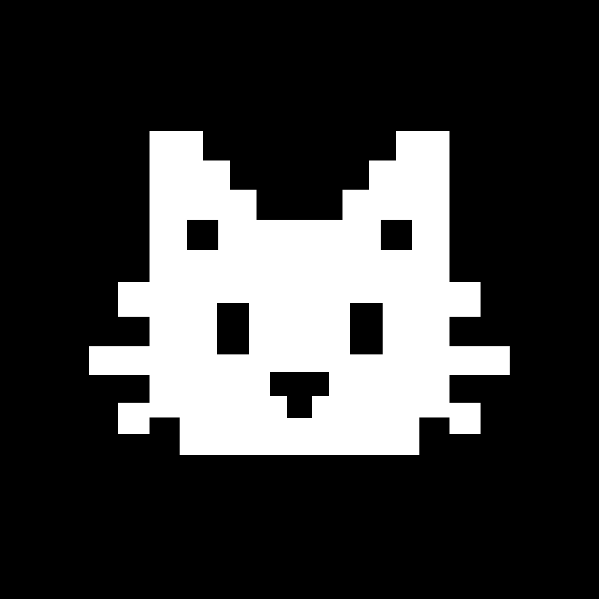

<div align="center">



# 一度コピーすれば、どのデバイスでも貼り付け

<strong>UniClipboard</strong> はパソコン間でクリップボードを同期します。<br />
アカウント不要。クラウドなし。メモリもほとんど使いません。

<a href="#quick-start"></a>
<a href="#features"></a>

<table>
  <tr>
    <td align="center" width="170"><h2>0</h2>作成するアカウント</td>
    <td align="center" width="170"><h2>0</h2>内容を保存するクラウドサーバー</td>
    <td align="center" width="170"><h2>14 MB</h2>バックグラウンド同期サービスのメモリ使用量<sup><a href="#benchmarks">1</a></sup></td>
    <td align="center" width="170"><h2>6 桁</h2>のコードで接続し、承認するだけ</td>
  </tr>
</table>

Windows · macOS · Linux · CLI　|　テキスト · 画像 · ファイル · フォルダ

<a href="README.md">English</a> | <a href="README.zh-CN.md">简体中文</a> | <a href="README.zh-TW.md">繁體中文</a> | <strong>日本語</strong> | <a href="README.pt-BR.md">Português (Brasil)</a> | <a href="README.ru.md">Русский</a>

</div>

---

## UniClipboard を選ぶ理由

- **クロスプラットフォーム**：Windows、macOS、Linux の間で同期。同じ Wi-Fi でも別のネットワークでもつながります。
- **クラウドを経由しない**：デバイス同士が暗号化された接続で直接つながります。登録不要で、履歴は自分のデバイスにだけ保存されます。
- **軽量**：バックグラウンド同期サービスはアイドル時に約 14 MB<sup>[1](#benchmarks)</sup>。Windows ではメインウィンドウが約 34–49 MB<sup>[2](#benchmarks)</sup>。閉じるとそのプロセスは終了します。
- **何でも同期**：テキスト、画像、ファイル、フォルダごと。

<a id="features"></a>

## 機能

| | |
|---|---|
| ⚡ **クイックパネル** | どのアプリでも `⌘ ⌃ V`（Windows / Linux は `Ctrl Alt V`）で履歴を開き、選んで Enter で貼り付け。 |
| 🔍 **すぐ見つかる** | キーワード入力、または `#タグ`・`@デバイス`・`/種類` で絞り込み。数か月前のコピーも見つかります。 |
| 🏷️ **自動タグ付け** | リンク、メール、カラーコード、バージョン番号、UUID、IP アドレスを自動でタグ付け。独自ルールも追加できます。 |
| 📁 **ファイルとフォルダ** | フォルダを構造ごと送信。全デバイスにも、特定のデバイスにも送れます。 |
| 📮 **ペアリングなしで送信** | `unic send "テキスト"` は転送リンクを表示します。利用できる場合は、6 桁の受け取りコードも表示します。受け取りにはどちらも使えます。デバイスの記録は残りません。 |
| 🧩 **プラグイン** | 設定からワンクリックでインストール。例：画像やファイルを共有リンクに変換。 |
| ⌨️ **コマンドライン** | `unic` でターミナル、SSH、スクリプトから送受信や履歴一覧の絞り込みができます。 |
| 🌍 **多言語** | English、简体中文、日本語、Português、Русский。ライト／ダークテーマ対応。 |

<a id="quick-start"></a>

## 3 ステップで開始

**1. 起動する**

[GitHub Releases](https://github.com/UniClipboard/UniClipboard/releases) から、使用するプラットフォームに対応した v2 デスクトッププレビューをダウンロードできます。ソースから起動する場合は、以下のコマンドを実行します。

```sh
git clone https://github.com/UniClipboard/UniClipboard.git
cd UniClipboard
make run-desktop
```

**2. 2 台目のデバイスを接続**

1 台目で **デバイス → デバイスを追加** を開き、6 桁のコードを控えて 2 台目に入力します。両方に同じフィンガープリントが表示されたら、それぞれで **承認** をクリックします。

**3. コピーする**

一方のデバイスで `Ctrl+C`、もう一方で `Ctrl+V`。

## コマンドライン

```sh
unic send --to all "Hello"        # 全デバイスへ送信
unic send --to all -f ./photos    # ファイルやフォルダを送信
unic send "一時的な内容"            # ペアリング不要：転送リンクと、利用可能な場合は受け取りコードを表示
unic recv 482913                  # コードで受信
unic history list                 # 履歴を表示
```

すべてのコマンドは [CLI ガイド](app/service/README.md) を参照してください。

<a id="benchmarks"></a>

## 実測値

| | メモリ | 条件 |
|---|---:|---|
| 同期サービス `unicd` | **14 MB** | macOS（Apple Silicon）、履歴なし、20 秒アイドル後に計測。アクティビティモニタの「メモリ」列と同じ指標<sup>1</sup> |
| メインウィンドウ | **34 MB** / 49 MB | Windows 11、ネイティブ ARM64 / x64 ビルド、テキスト 60 件。タスクマネージャーの指標<sup>2</sup> |
| メインウィンドウ（画像あり） | 119 MB / 133 MB | 同上に 2048×1536 の画像 12 枚を追加<sup>2</sup> |

<sup>1</sup> コミット `e2cb68d` で `footprint <pid>` により計測。<sup>2</sup> 3 回の中央値。詳細は [Windows メモリレポート](docs/exec/windows-desktop-memory.md)。

## プライバシー

- デバイス間はエンドツーエンドで暗号化されます。UniClipboard はクリップボードを保存するサーバーを運営していません。
- 新しいデバイスはすべて、フィンガープリントを確認して承認する必要があります。削除したデバイスは即座にアクセスできなくなります。
- クリップボードの内容、ファイルパス、デバイスアドレスはログに記録されません。
- 匿名の診断データにクリップボードの内容やデバイス識別情報は含まれません。**設定 → 診断とプライバシー** でいつでもオフにできます。

セキュリティ上の問題は [SECURITY.md](SECURITY.md) の手順で非公開に報告してください。

## UniClipboard v1 からのアップグレード

v2 は v1 の履歴（テキスト、画像、ファイル、タグ）をすべてインポートできます。v2 を初めて開いたときの案内に従うか、あとで **設定 › ストレージ › v1 から移行** からインポートしてください。

v2 のデバイスは v1 のデバイスと同期できません。すべてのデバイスを v2 にアップグレードし、ペアリングし直してください。v1 のコードは [`v1` ブランチ](https://github.com/UniClipboard/UniClipboard/tree/v1) にあります。

## 開発に参加する

```sh
make build            # dist/
go test -race ./...
```

まず [CONTRIBUTING.md](CONTRIBUTING.md) と [アーキテクチャドキュメント](docs/architecture/README.md) をお読みください。プラグインの作り方は [プラグインガイド](plugins/README.md) を参照してください。

## ライセンス

[AGPL-3.0](LICENSE)
