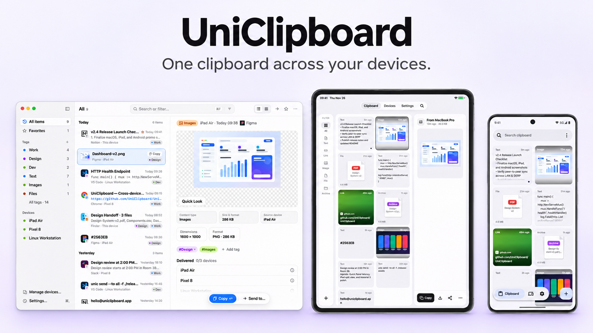
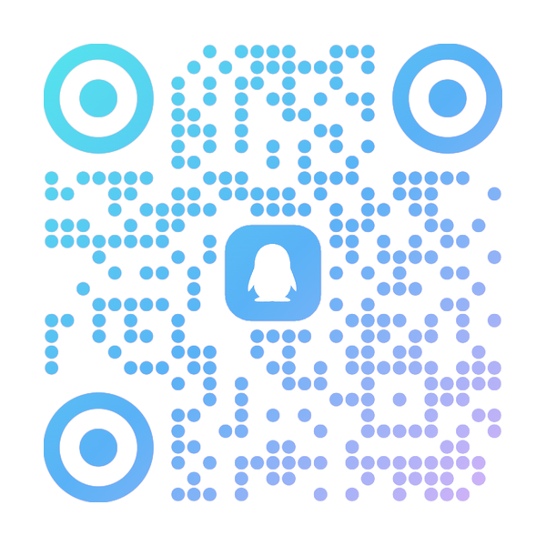

<div align="center">


# Copie uma vez. Cole em qualquer dispositivo.

<p>
  O <strong>Unic (anteriormente UniClipboard)</strong> sincroniza texto, imagens, arquivos e pastas diretamente entre seus dispositivos.<br />
  Criptografia de ponta a ponta. Sem conta. Sem nuvem.
</p>

<p>
  <a href="https://github.com/UniClipboard/UniClipboard/releases"></a>
  <a href="https://testflight.apple.com/join/nyNQ8dQe"></a>
  <a href="#quick-start"></a>
</p>

<p>
  <a href="https://uniclipboard.app"></a>
  <a href="https://docs.uniclipboard.app"></a>
  <a href="#community"></a>
  <a href="#community"></a>
  <a href="https://t.me/uniclipboard"></a>
</p>

<p>
  <a href="https://github.com/UniClipboard/UniClipboard/stargazers"></a>
  <a href="https://github.com/UniClipboard/UniClipboard/releases"></a>
  <a href="https://github.com/UniClipboard/UniClipboard/releases"></a>
  <a href="LICENSE"></a>
</p>

<p>
  <a href="https://github.com/UniClipboard/UniClipboard/releases"></a>
  <a href="https://github.com/UniClipboard/UniClipboard/releases"></a>
  <a href="https://github.com/UniClipboard/UniClipboard/releases"></a>
  <a href="https://testflight.apple.com/join/nyNQ8dQe"></a>
  <a href="https://github.com/UniClipboard/UniClipboard/releases"></a>
  <a href="#cli"></a>
</p>

<p>
  <small>
    <a href="README.md">English</a> | <a href="README.zh-CN.md">简体中文</a> | <a href="README.zh-TW.md">繁體中文</a> | <a href="README.ja.md">日本語</a> | <strong>Português (Brasil)</strong> | <a href="README.ru.md">Русский</a>
  </small>
</p>



</div>

---

## Por que o Unic

- **Multiplataforma**: sincroniza entre Windows, macOS, Linux, iOS e Android, na mesma rede Wi-Fi ou em redes diferentes.
- **Sem nuvem**: os dispositivos se conectam diretamente por canais criptografados. Sem cadastro. O histórico fica só nos seus dispositivos.
- **Leve**: o serviço de sincronização usa cerca de 14 MB de memória em repouso. No Windows, a janela principal usa cerca de 34–49 MB. Ao fechá-la, o processo dela termina.
- **Sincroniza tudo**: texto, imagens, arquivos e pastas inteiras.

<a id="features"></a>

## Recursos

<table>
  <tr>
    <td>⚡ <strong>Painel rápido</strong></td>
    <td>Pressione <code>⌘ ⌃ V</code> (<code>Ctrl Alt V</code> no Windows / Linux) em qualquer app, escolha um item e pressione Enter para colar.</td>
  </tr>
  <tr>
    <td>🔍 <strong>Encontre tudo</strong></td>
    <td>Digite uma palavra ou filtre com <code>#etiqueta</code>, <code>@dispositivo</code> ou <code>/tipo</code>. Encontre o que copiou há meses.</td>
  </tr>
  <tr>
    <td>🏷️ <strong>Etiquetas automáticas</strong></td>
    <td>Links, e-mails, cores, números de versão, UUIDs e endereços IP recebem etiquetas automaticamente. Crie suas próprias regras.</td>
  </tr>
  <tr>
    <td>📁 <strong>Arquivos e pastas</strong></td>
    <td>Envie uma pasta inteira com a estrutura preservada, para todos os dispositivos ou só um.</td>
  </tr>
  <tr>
    <td>📮 <strong>Envio sem pareamento</strong></td>
    <td><code>unic send "texto"</code> mostra um link de transferência e, quando disponível, um código de 6 dígitos. Quem recebe pode usar um ou outro. Nenhum registro de dispositivo fica salvo.</td>
  </tr>
  <tr>
    <td>🧩 <strong>Plugins</strong></td>
    <td>Instale plugins com um clique nas Configurações, por exemplo para transformar uma imagem ou arquivo em link de compartilhamento.</td>
  </tr>
  <tr>
    <td>⌨️ <strong>Linha de comando</strong></td>
    <td>Use <code>unic</code> para enviar, receber e filtrar a lista do histórico pelo terminal, via SSH ou em scripts.</td>
  </tr>
  <tr>
    <td>🌍 <strong>Idiomas</strong></td>
    <td>English, 简体中文, 日本語, Português, Русский. Temas claro e escuro.</td>
  </tr>
</table>

<a id="quick-start"></a>

## Comece em 3 passos

**1. Baixe e instale**

- **Desktop**: baixe o instalador para Windows (`.exe`/`.zip`), macOS (`.dmg`) ou Linux (`.deb`/`.rpm`/`.AppImage`) no [GitHub Releases](https://github.com/UniClipboard/UniClipboard/releases).
- **iOS**: participe do beta público pelo [TestFlight](https://testflight.apple.com/join/nyNQ8dQe).
- **Android**: baixe e instale o APK pelo [GitHub Releases](https://github.com/UniClipboard/UniClipboard/releases) (sem planos de publicação na Google Play no momento).
- **Somente CLI**: execute `npm install -g @uniclipboard/cli`.

[](https://repology.org/project/uniclipboard/versions)

**2. Conecte um segundo dispositivo**

No primeiro dispositivo, abra **Dispositivos → Adicionar dispositivo** e anote o código de 6 dígitos. Digite-o no segundo dispositivo. Quando os dois mostrarem a mesma impressão digital, clique em **Aceitar** em cada um.

**3. Copie**

Pressione `Ctrl+C` em um dispositivo e `Ctrl+V` no outro.

<a id="cli"></a>

## Linha de comando

```sh
unic send --to all "Hello"        # enviar para todos os dispositivos
unic send --to all -f ./photos    # enviar arquivos ou uma pasta
unic send "temporário"            # sem pareamento: mostra um link e, quando disponível, um código
unic recv 482913                  # receber com o código
unic history list                 # ver o histórico
```

Veja todos os comandos no [guia da CLI](app/service/README.md).

## Privacidade

- O conteúdo é criptografado de ponta a ponta entre dispositivos. O Unic não mantém servidores que guardem sua área de transferência.
- Você confere uma impressão digital e aprova cada novo dispositivo. Um dispositivo removido perde o acesso na hora.
- Conteúdo copiado, caminhos de arquivos e endereços de dispositivos nunca vão para os logs.
- O diagnóstico anônimo não inclui conteúdo nem identidade do dispositivo. Desative quando quiser em **Configurações → Diagnóstico e privacidade**.

Relate problemas de segurança de forma privada, conforme o [SECURITY.md](SECURITY.md).

## Atualizando do UniClipboard v1

O v2 importa todo o seu histórico do v1: texto, imagens, arquivos e etiquetas. Siga o assistente ao abrir o v2 pela primeira vez ou importe depois em **Configurações › Armazenamento › Migrar da v1**.

Dispositivos v2 não sincronizam com dispositivos v1. Atualize todos para o v2 e pareie novamente. O código do v1 está no [branch `v1`](https://github.com/UniClipboard/UniClipboard/tree/v1).

<a id="community"></a>

## Comunidade

Participe da comunidade do Unic para trocar ideias, tirar dúvidas, enviar sugestões e conversar com outros usuários e desenvolvedores:

-  Grupo do QQ: `1080860954`
-  WeChat: escaneie o QR code abaixo para adicionar o mantenedor e entrar no grupo
-  [Grupo do Telegram (@uniclipboard)](https://t.me/uniclipboard)

<table>
  <tr>
    <td align="center"><strong> Grupo do QQ</strong></td>
    <td align="center"><strong> Grupo do WeChat</strong></td>
    <td align="center"><strong> Telegram</strong></td>
  </tr>
  <tr>
    <td align="center"></td>
    <td align="center"></td>
    <td align="center"><a href="https://t.me/uniclipboard"></a></td>
  </tr>
</table>

## Contribuindo

```sh
make build            # dist/
go test -race ./...
```

Leia primeiro o [CONTRIBUTING.md](CONTRIBUTING.md) e a [documentação de arquitetura](docs/architecture/README.md). Para criar um plugin, veja o [guia de plugins](plugins/README.md).

## Licença

[AGPL-3.0](LICENSE)
