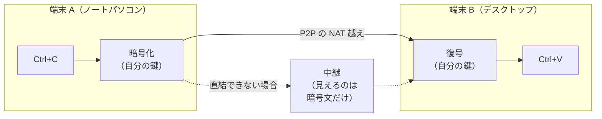

<!-- Translation of README.md; keep commands, links, and section coverage in sync. -->

<div align="center">
  <h1>UniClipboard</h1>
  <a href="https://github.com/UniClipboard/UniClipboard/releases">
    
  </a>
  <a href="https://github.com/UniClipboard/UniClipboard/releases">
    
  </a >
  <a href="https://github.com/UniClipboard/UniClipboard/releases">
    
  </a>
  <a href="#mobile-companion-lan">
    
  </a>
  <a href="#mobile-companion-lan">
    
  </a>

  <div>
    <a href="./LICENSE">
      
    </a >
    <a href="https://github.com/UniClipboard/UniClipboard/releases">
      
    </a >
    <a href="https://codecov.io/gh/UniClipboard/UniClipboard" >
      
    </a>
  </div>

</div>

<p align="center"><a href="./README.md">English</a> | <a href="./README_ZH.md">简体中文</a> | <a href="./README_ZH_TW.md">繁體中文</a> | 日本語 | <a href="./README_RU.md">Русский</a> | <a href="./README_PT_BR.md">Português (Brasil)</a></p>
<p align="center"><a href="./ABOUT.md">このプロジェクトの運営者について（運営と信頼・英語）</a></p>

<a id="project-overview"></a>

## プロジェクト概要

> **ある端末でコピーし、別の端末で貼り付ける。インターネット越しでも。**
>
> クラウドアカウントは不要です。第三者のサーバーに依存せず、クリップボードの内容が他人に読める状態で端末の外に出ることはありません。

UniClipboard は、**プライバシーを最優先**するクリップボードツールです。
コピーした内容を暗号化された検索可能な履歴として保存し、クイックパネルからすぐに呼び出せます。同じ Wi-Fi 上でも異なるネットワーク上でも、テキスト、画像、ファイルを端末間で同期できます。クリップボードの内容は転送中にエンドツーエンドで暗号化され、保存時も暗号化されたままです。復号は自分の端末でのみ行われるため、中継サーバーや経路上のネットワークが見ることのできるのは暗号文だけです。

<p align="center">
  
</p>

<p align="center">
  <video src="https://github.com/user-attachments/assets/367c7f45-579a-49b7-bc96-9ccc25cf5ad0" controls muted playsinline width="800"></video>
  <br/>
  <em>デスクトップ間で、クリップボードをリアルタイムに双方向同期。</em>
</p>

<details>
  <summary><strong>モバイル版のデモ</strong> — スマートフォンのスクリーンショットをパソコンへ送信。（クリックで展開）</summary>
  <p align="center">
    <video src="https://github.com/user-attachments/assets/29f4bf5d-8996-4602-8784-067fb919c671" controls muted playsinline width="800"></video>
  </p>
</details>

> [!IMPORTANT]
> **0.19.x からアップグレードしますか？** 1.0 は後方互換性のない更新です。ローカルデータは新形式に変換され、その後は 0.19 に戻せません。同期を再開するには、すべての端末を 1.0 に更新し、再度ペアリングしてください。更新前に [0.19 → 1.0 アップグレードガイド](https://docs.uniclipboard.app/migration/upgrade-0-19-to-v1)をお読みください。

<a id="table-of-contents"></a>

## 目次

- [主な機能](#features)
- [インストール](#installation)
  - [Releases からダウンロード](#download-from-releases)
  - [ワンラインインストール（Linux / macOS）](#one-line-install-script-linux--macos)
  - [Linux](#linux)
  - [Homebrew (macOS)](#homebrew-macos)
  - [0.19.x からのアップグレード](#upgrading-from-019x)
  - [ソースからビルド](#build-from-source)
- [使い方](#usage)
  - [最初の端末でスペースを作成](#first-device-create-a-space)
  - [招待で端末を追加](#adding-more-devices-join-via-invitation)
  - [スマートフォンを接続](#mobile-companion-lan)
  - [主な画面](#main-pages)
- [高度な機能](#advanced-features)
  - [仕組み](#how-it-works)
  - [コマンドラインツール](#command-line-tool)
  - [プライバシーとセキュリティ](#privacy--security)
- [よくある質問](#faq)
- [貢献する](#contributing)
- [ライセンス](#license)
- [謝辞](#acknowledgments)
- [コミュニティ](#community)

<a id="features"></a>

## 主な機能

- **Windows、macOS、Linux 向けデスクトップアプリ**：x86_64 と ARM64 向けのネイティブインストーラー（macOS は Apple Silicon / Intel に対応）に加え、独立した `uniclip` CLI を提供します。
- **ローカル全文検索**：候補表示やキーボード補完を使って履歴全体をすばやく検索できます。検索インデックス自体もディスク上で暗号化されます。
- **クイックパネル**：ショートカットで呼び出せるオーバーレイから、テキスト、リンク、画像、コード、ファイルをプレビューできます。グローバルショートカットが使えない Linux デスクトップでは、デスクトップショートカットから開けます。
- **ネットワークをまたぐ同期**：同一ネットワーク内でもインターネット越しでも、NAT 越えによる直接接続を試みます。直接接続できない場合は暗号化された中継経路を使います。自分の中継サーバーも追加できます。
- **暗号化されたスペース**：有効期間の短い招待コードとスペースのパスフレーズを使って、共通の「スペース」に端末を追加します。クラウドアカウントもメールアドレスも不要です。
- **テキスト、画像、ファイル**：一方の端末でコピーして、もう一方で貼り付けられます。大きなファイルはストリーミングで転送し、受信中の転送はアプリ再起動後も継続します。複数項目の転送は進捗をまとめて表示し、キャンセルできます。
- **端末ごとの同期制御**：ペアリング済み端末ごとに送受信する種類を選べます。すべての同期と自動同期を別々に一時停止でき、手動送信は利用できます。トレイから端末ごとの同期も切り替えられます。再接続した端末には、受信できなかった最新の 1 件が送られます。
- **コマンドラインツール**：`uniclip` は画面なしで初期設定、ペアリング、送受信、メンバー管理を行えます。端末、SSH、スクリプト、サーバーでの利用に適しています。
- **複数端末の管理**：各端末の接続状態や同期設定を確認でき、紛失した端末をほかのペアリング済み端末から削除できます。
- **安全な更新と復旧**：更新前にローカルデータを自動バックアップします。システムに保存された鍵が失われても、元のスペースのパスフレーズで復旧できます。
- **モバイルアプリ**：iOS / Android 向けの [UniClipboard モバイルアプリ](https://github.com/UniClipboard/UniClip)をデスクトップに接続できます。[スマートフォンを接続](#mobile-companion-lan)を参照してください。
- **多言語 UI**：英語、簡体字中国語、繁体字中国語、日本語、ロシア語、ブラジルポルトガル語。

<a id="installation"></a>

## インストール

<!-- package-manager-versions:start -->
お好みのパッケージマネージャーを使うか、以下のダウンロード方法を選んでください。バージョンのバッジから公開済みパッケージのページを開けます。

| プラットフォーム | パッケージマネージャー | 現在のバージョン | インストールコマンド |
| --- | --- | --- | --- |
| macOS | Homebrew | [](https://formulae.brew.sh/cask/uniclipboard) | `brew install --cask uniclipboard` |
| Windows | WinGet | [](https://github.com/microsoft/winget-pkgs/tree/master/manifests/u/UniClipboard/UniClipboard) | `winget install --id UniClipboard.UniClipboard -e` |
| Windows | Scoop | [](https://github.com/ScoopInstaller/Extras/blob/HEAD/bucket/uniclipboard.json) | `scoop install extras/uniclipboard` |
| Windows | Chocolatey | [](https://community.chocolatey.org/packages/uniclipboard) | `choco install uniclipboard` |
| Arch Linux | AUR | [](https://aur.archlinux.org/packages/uniclipboard-git) | `yay -S uniclipboard-git` |
| Linux | Snap | [](https://snapcraft.io/uniclipboard) | `sudo snap install uniclipboard` |
| macOS / Windows / Linux | npm (CLI) | [](https://www.npmjs.com/package/@uniclipboard/cli) | `npm install -g @uniclipboard/cli` |
| Linux | Flathub | [](https://flathub.org/apps/app.uniclipboard.desktop) | 未公開 |

Scoop では Extras バケットの追加が必要です（`scoop bucket add extras`）。AUR は main ブランチを追跡します。Flathub ではまだ公開されていません。

<details>
<summary>その他の配布先とバージョンについて</summary>

COPR と実験的な Nix flake の手順は [Linux](#linux)、プロジェクトの tap と CLI は [Homebrew](#homebrew-macos) を参照してください。プレリリースやほかの配布先は [全配布先の状態](https://github.com/UniClipboard/UniClipboard/blob/package-status/status.json) で確認できます。Shields.io のバッジはキャッシュのため更新が遅れることがあります。

</details>
<!-- package-manager-versions:end -->

<a id="download-from-releases"></a>

### Releases からダウンロード

[GitHub Releases](https://github.com/UniClipboard/UniClipboard/releases/latest) から最新版をダウンロードできます。

| プラットフォーム | パッケージ |
| --- | --- |
| macOS | Apple Silicon / Intel 向け `.dmg` |
| Windows | x86_64 / ARM64 向けインストーラー（`-setup.exe`）とポータブル版 `.zip` |
| Linux | x86_64 / aarch64 向けの `.deb`、`.rpm`、`.AppImage` |
| CLI のみ | macOS、Linux（musl）、Windows x86_64 向けの `uniclipboard-cli-*` アーカイブ |

各リリースには検証用の `.sig` 署名ファイルと、署名付き `SHA256SUMS.txt` が付属します。

<a id="one-line-install-script-linux--macos"></a>

### ワンラインインストール（Linux / macOS）

手動でパッケージを選ばず、次のコマンドでもインストールできます。

```bash
curl -fsSL https://uniclipboard.app/install.sh | bash
```

スクリプトは最新の安定版をインストールし、OS と CPU を自動判別します。

- **macOS** — `.app.tar.gz` をダウンロードして展開し、`UniClipboard.app` を `/Applications` に移動します。書き込み権限がない場合は `sudo` を使用します。ユーザー単位でインストールするには `--prefix "$HOME/Applications"` を指定してください。
- **Linux** — sudo が使える場合、apt 系では `.deb`、dnf 系では COPR リポジトリを使います（Ubuntu 20.04 は Snap）。それ以外は AppImage を `~/.local/bin` に配置し、`.desktop` を登録します。root は不要です。

よく使うオプション：

```bash
# Pin a specific version
curl -fsSL https://uniclipboard.app/install.sh | bash -s -- --version v1.0.1

# Force AppImage (rootless even when sudo is available)
curl -fsSL https://uniclipboard.app/install.sh | bash -s -- --format appimage
```

アンインストールには対応するスクリプトを使用します。

```bash
# Remove the app only, keep data and config
curl -fsSL https://raw.githubusercontent.com/UniClipboard/UniClipboard/main/scripts/uninstall.sh | bash

# Full wipe — also removes data directories, config, and cache
curl -fsSL https://raw.githubusercontent.com/UniClipboard/UniClipboard/main/scripts/uninstall.sh | bash -s -- --purge

# Preview what would be removed without deleting anything
curl -fsSL https://raw.githubusercontent.com/UniClipboard/UniClipboard/main/scripts/uninstall.sh | bash -s -- --dry-run
```

> 更新方法は以下の手動ダウンロードと同じです。`.deb` / `.rpm` / COPR / Snap はシステムのパッケージマネージャーで更新し、アプリ内更新は使いません。Linux の AppImage と macOS の `.app` はアプリ内から更新します。

<a id="linux"></a>

### Linux

各リリースには `x86_64` と `aarch64` 向けの `.deb`、`.rpm`、`.AppImage` が含まれます。

**Fedora / RHEL / openSUSE — COPR を利用（推奨・自動更新）**

```bash
sudo dnf copr enable mkdir700/uniclipboard         # stable; mkdir700/uniclipboard-alpha for pre-releases
sudo dnf install uniclipboard
```

有効化後は `sudo dnf upgrade` で新しいリリースを取得できます。

**Snap**

```bash
sudo snap install uniclipboard
```

**Nix（x86_64 / aarch64、実験的）**

```bash
nix run github:UniClipboard/UniClipboard          # try it
nix profile add github:UniClipboard/UniClipboard  # install (older Nix: nix profile install)
```

`nix-command` と `flakes` の実験的機能を有効にしてください。この flake は公開済み `.deb` を再パッケージし、現在はプレリリースを固定しています。NixOS の設定、既知の制限、検証状況は [`packaging/nix/README.md`](packaging/nix/README.md) を参照してください。アプリ内更新ではなく Nix で更新し、Nix でのインストールではアプリ内のログイン時起動スイッチも使わないでください。

**Releases から個別の .rpm / .deb / AppImage をダウンロードすることもできます。**

```bash
# Debian / Ubuntu
sudo dpkg -i UniClipboard_<version>_amd64.deb
sudo apt-get install -f                                 # resolve missing deps if any

# Fedora / RHEL / openSUSE (one-shot, no COPR)
sudo dnf install ./UniClipboard-<version>-1.x86_64.rpm

# AppImage (any distro)
chmod +x UniClipboard_<version>_amd64.AppImage
./UniClipboard_<version>_amd64.AppImage
```

> COPR / Snap / rpm / deb でインストールした場合は、アプリ内の自動更新ではなくパッケージマネージャーを使用してください。Linux のアプリ内更新は AppImage 用です。

<a id="homebrew-macos"></a>

### Homebrew (macOS)

macOS では公式 tap [`UniClipboard/homebrew-tap`](https://github.com/UniClipboard/homebrew-tap) からインストールできます。

```bash
brew tap UniClipboard/tap

# Homebrew 6.0+ requires you to trust third-party taps before it will load
# their formulae/casks. Skip this and you'll hit
# "Refusing to load ... from untrusted tap". It only needs to run once.
brew trust UniClipboard/tap

# Desktop app (.app bundle)
brew install --cask uniclipboard

# CLI only — installs the `uniclip` command
brew install uniclipboard
```

先に tap を追加せず、次のコマンドで直接インストールすることもできます。tap の信頼設定は一度必要です。

```bash
brew trust UniClipboard/tap                          # Homebrew 6.0+, one-time
brew install --cask UniClipboard/tap/uniclipboard    # GUI
brew install UniClipboard/tap/uniclipboard           # CLI
```

cask と formula は共存できます。GUI と `uniclip` コマンドの両方が必要なら両方をインストールしてください。

<a id="upgrading-from-019x"></a>

### 0.19.x からのアップグレード

1.0 はローカルデータの保存・保護形式を変換し、新しいペアリング方式を使用します。

- 同じインストール方法で上書き更新してください。初回起動時に履歴を自動バックアップするため、通常より時間がかかります。
- 更新後は 0.19 に戻せません。また 0.19 と 1.0 の端末同士では同期できません。
- 更新時に古いペアリングは消去されます。全端末を 1.0 にしたら、**デバイス** 画面から再度ペアリングしてください。

更新順序、バックアップ先、復旧手順は [0.19 → 1.0 アップグレードガイド](https://docs.uniclipboard.app/migration/upgrade-0-19-to-v1) を参照してください。

<a id="build-from-source"></a>

### ソースからビルド

必要なもの：`rust-toolchain.toml` で固定された Rust ツールチェーン、[Bun](https://bun.sh)、[Go](https://go.dev)（バージョンは `apps/gui-go/go.mod`）、OS に対応する [Wails v3 の前提条件](https://v3alpha.wails.io/getting-started/installation/)。開発コマンド `bun wails:dev` は macOS と Windows に対応しています。

```bash
git clone https://github.com/UniClipboard/UniClipboard.git
cd UniClipboard

# Install dependencies
bun install

# Start development mode (isolated `dev` profile, so it doesn't touch an installed app's data)
bun wails:dev

# Build a local macOS app bundle
apps/gui-go/build.sh
```

バンドル構成は `apps/gui-go/README.md` を参照してください。複数端末での開発、テスト、プロジェクト規約は [CONTRIBUTING.md](./CONTRIBUTING.md)（英語）に記載しています。

<a id="usage"></a>

## 使い方

<a id="first-device-create-a-space"></a>

### 最初の端末でスペースを作成

1. アプリを起動し、**最初のデバイスです**を選択して、**新しいスペースを開始**をクリックします。
2. 暗号化パスフレーズを設定します。スペース内の全データを保護し、端末の追加にも必要なので、大切に保管してください。
3. 完了です。コピーした内容は、このスペースに暗号化して保存されます。

<a id="adding-more-devices-join-via-invitation"></a>

### 招待で端末を追加

1. 既存端末の**デバイス** 画面で**デバイスを招待**をクリックし、有効期間の短い招待コードを生成します。
2. 新しい端末で**ほかの場所で UniClipboard を使用しています** → **ペアリングで参加**を選択し、招待コードとスペースのパスフレーズを入力します。
3. ペアリングが確認されると端末が参加し、自動同期が始まります。

> 設定済みの端末を別のスペースへ移すには、デバイス画面の**別のスペースに参加**、または CLI の `uniclip space join --switch` を使います。ローカルのクリップボード履歴は新しいスペースに移行されます。`--switch` を付けない `uniclip space join` は非破壊的な再ペアリングで、スペースは切り替えません。

### スマートフォンを接続 <a id="mobile-companion-lan"></a>

**[UniClipboard モバイルアプリ](https://github.com/UniClipboard/UniClip)**は **iOS**（[TestFlight 公開ベータ](https://testflight.apple.com/join/nyNQ8dQe)）と **Android**（[APK ダウンロード](https://github.com/UniClipboard/UniClip/releases/latest)）に対応します。デスクトップで**デバイス**を開き、電話アイコンから**スマートフォンを接続**を開くと、次の 2 つの方法を選べます。

- **通常同期**（既定）— HTTP 互換モードです。デスクトップの daemon が SyncClipboard 互換の小さな HTTP サービスを実行します。ダイアログでスマートフォンを登録し、アドレスと一度限りの認証情報を含む QR コードをアプリで読み取ります。
- **デバイス接続（実験的）** — ほかのデスクトップと同様に、招待コードで暗号化スペースに参加します。

通常同期の制限：

- **P2P ではありません** — スマートフォンは NAT 越えや中継機能のない HTTP クライアントです。ローカルネットワークで動作します。異なるネットワークでは、[ヘッドレスサーバーノード](https://docs.uniclipboard.app/guides/self-host-server-node)（公開 HTTPS）、または Tailscale / VPN を利用してください。
- **リスナーは平文 HTTP + Basic Auth** — 信頼できるネットワークでのみ有効にするか、TLS リバースプロキシの背後に配置してください。
- **スマートフォンはスペースのメンバーではありません** — ノード ID は与えられず、暗号化された履歴データベースも読み取れません。
- **iOS での無操作のバックグラウンド同期はできません** — iOS は汎用のバックグラウンドクリップボード監視を提供しないため、アプリが前面にあるとき、またはキーボード・共有拡張から同期します。[よくある質問 — iOS のバックグラウンド同期](https://docs.uniclipboard.app/help/faq#why-cant-the-ios-app-sync-clipboard-silently-in-the-background-like-the-desktop)を参照してください。

> ⚠️ TestFlight で証明書エラーが出たり、**インストール**が進まない場合は、プロキシ / VPN（グローバルルール、TUN、HTTPS 復号 / MitM を含む）を一時的に無効にし、TestFlight を直接接続させてください。インストール後に戻せます。

詳しい手順は[モバイルアプリガイド](https://docs.uniclipboard.app/mobile)と[デスクトップのモバイル同期ガイド](https://docs.uniclipboard.app/core-features/mobile-sync)を参照してください。

<a id="main-pages"></a>

### 主な画面

- **履歴** — 全文検索、フィルター、詳細プレビュー付きのクリップボード履歴
- **クイックパネル** — ショートカットでクリップボードにすばやくアクセスするオーバーレイ
- **デバイス** — 端末の招待、スマートフォン接続、接続状態、端末別同期、スペースの切り替えや再構築
- **設定** — 全般、外観、ショートカット、クイックパネル、同期、セキュリティ、ネットワーク、ストレージ（更新バックアップを含む）、アプリ情報

<a id="advanced-features"></a>

## 高度な機能

<a id="how-it-works"></a>

### 仕組み



- **ペアリング**：新しい端末は一度限りの招待コードとスペースのパスフレーズで参加します。クラウドアカウントやメールは不要です。
- **転送**：同じネットワーク内、または NAT 越えで直接到達できる場合は直接接続します。それ以外は暗号化された中継経路を使います。
- **暗号化**：内容の暗号化は転送方式と独立しています。悪意ある中継サーバーでも暗号文しか見えません。
- **保存**：ローカル履歴、プレビュー、検索インデックスは保存時に暗号化されます。
- **回復性**：ネットワーク変更、スリープからの復帰、短時間の切断後に自動再接続します。デバイス画面から接続を更新することもできます。

**構成要素。** デスクトップアプリは GUI（Go/Wails + React）、同期と保存を担当するバックグラウンド daemon `uniclipd`、`uniclip` CLI の 3 部分からなります。GUI と CLI はループバック HTTP / WebSocket API で同じローカル daemon に接続するため、常に同じ状態を表示します。同期、暗号化、保存は別の [UniClipboard Engine](https://github.com/UniClipboard/Engine) リポジトリで実装し、このリポジトリの `Cargo.toml` で固定リビジョンを指定しています。

<a id="command-line-tool"></a>

### コマンドラインツール

`uniclip` CLI は GUI の有無に関係なく、サーバーなどでも動作します。主なコマンド：

```bash
uniclip space init                          # Create a new encrypted space on this device
uniclip space invite                        # Generate a short-lived invitation code
uniclip space change-passphrase             # Change the space passphrase (unlocked, single-device space)
uniclip space join --code <code>            # Join a space (re-pair, non-destructive)
uniclip space join --switch --code <code>   # Switch to another space
uniclip space status                        # Inspect the active space and daemon
uniclip member list                         # List paired devices and presence
uniclip send "hello"                        # Send text to other devices
uniclip send ./report.pdf                   # Send an existing file
printf '%s\n' ./a.png './b c.pdf' | uniclip send --file   # Send paths from stdin
uniclip send --text report.pdf              # Force an existing filename to be sent as text
uniclip get                                 # Fetch the latest entry
uniclip get --wait                          # Wait for the next synced entry
uniclip get --copy                          # Copy the latest entry to this computer's clipboard
uniclip search "invoice"                    # Search clipboard history
uniclip run                                # Foreground daemon lifecycle
uniclip service start / restart / status / stop # User service lifecycle
```

全コマンドは `uniclip --help`、または [CLI リファレンス](https://docs.uniclipboard.app/cli/reference)を参照してください。

<a id="privacy--security"></a>

### プライバシーとセキュリティ

**収集する情報** — 診断情報（クラッシュ、エラー、機密情報を除去したログ）と利用分析（設定や同期の結果などの製品イベント）の、独立した匿名の 2 経路です。クリップボードの内容、ファイル名やパス、パスフレーズや鍵、検索語は含みません。どちらも既定で有効ですが、初回起動時の通知で両方を無効化でき、**設定 → 全般 → プライバシー**で個別に変更できます。正確な項目は[プライバシーとデータ収集](https://docs.uniclipboard.app/core-features/privacy)を参照してください。

**中継サーバーが見られるもの** — 暗号化されたバイト列と接続メタデータ（送信元 / 送信先ピア ID）です。内容は復号できません。

**ディスクに保存されるもの** — 暗号化された SQLite データベースと検索インデックスです。クリップボードの本文、タイトル、プレビュー、タグ、ファイル名は書き込む前に暗号化されます。

**端末を紛失した場合** — ほかのペアリング済み端末から削除してください。ほかの端末は、その端末への新しい内容の送信を停止します。

**監査できます** — デスクトップアプリと [Engine](https://github.com/UniClipboard/Engine) は、暗号処理を含め GitHub で公開されています。

<a id="cryptography-details"></a>

#### 暗号方式の詳細

- クリップボードの内容には **XChaCha20-Poly1305 AEAD** を使用し、24 バイトのランダム nonce と 256 ビット鍵で機密性、完全性、真正性を保護します。
- **Argon2id** がスペースのパスフレーズから鍵暗号化用の素材を導出します（既定：メモリ 128 MiB、反復 3 回、4 レーン）。GPU / ASIC による解読に耐性があります。
- **階層化された鍵**：内容の鍵はプロファイル別の暗号化された鍵保管庫にあります。システムの安全なストレージ（macOS Keychain、Windows Credential Manager、Linux Secret Service）には自動ロック解除用の素材だけを保存します。それが失われても、元のパスフレーズでアクセスを復旧できます。
- **スペースごとの分離**：各スペースは独立した鍵を持ちます。

<a id="faq"></a>

## よくある質問

<details>
  <summary><strong>iCloud のユニバーサルクリップボードではだめですか？</strong></summary>

Apple 製品だけを使い、履歴が不要で、非公開のエンドツーエンド暗号化を完全に信頼するなら、iCloud で十分です。Windows / Linux を追加したい、検索可能な履歴が欲しい、暗号化を自分で検証したい場合には、別の選択肢が必要です。
</details>

<details>
  <summary><strong>ClipCascade などのセルフホスト型ではだめですか？</strong></summary>

セルフホスト型ではサーバーの運用が必要です。UniClipboard はすぐに使え、P2P の直接接続を優先し、暗号化された中継は接続できない場合だけ使います。インフラを運用する必要はありません。
</details>

<details>
  <summary><strong>中継サーバーなしで LAN 内でも使えますか？</strong></summary>

同じネットワークで相互に到達できる端末は、中継を経由せず直接接続します。**設定 → ネットワーク → LAN のみモード**では中継へのフォールバックを完全に無効にし、異なるネットワークの端末とは接続できなくなります。このモードでもインターネットにアクセスする項目は [FAQ](https://docs.uniclipboard.app/help/faq) を参照してください。
</details>

<details>
  <summary><strong>クリップボード履歴はどこに保存されますか？</strong></summary>

自分の端末内だけに、暗号化して保存されます。UniClipboard のサーバーがクリップボードの内容を受信・保存することはありません。
</details>

<details>
  <summary><strong>モバイルアプリはありますか？</strong></summary>

はい。**[UniClipboard モバイルアプリ](https://github.com/UniClipboard/UniClip)**は iOS と Android に対応します。既定では通常同期を使い、招待コードでスペースに参加する実験的なデバイス接続モードもあります。[スマートフォンを接続](#mobile-companion-lan) を参照してください。
</details>

<details>
  <summary><strong>0.19 から更新後、端末間で同期できなくなりました。</strong></summary>

これは想定された動作です。1.0 は新しいペアリング方式を使うため、古いペアリングは消去され、0.19 と 1.0 の端末同士ではペアリングできません。全端末を 1.0 に更新し、再ペアリングしてください。[アップグレードガイド](https://docs.uniclipboard.app/migration/upgrade-0-19-to-v1) を参照してください。
</details>

<a id="contributing"></a>

## 貢献する

どのような形の貢献も歓迎します。開発環境、ブランチ方針、コミット規約、PR 手順は [CONTRIBUTING.md](./CONTRIBUTING.md)（英語）をお読みください。

はじめ方：

1. このリポジトリを Fork します。
2. 作業用ブランチを作成します（`git checkout -b feature/amazing-feature`）。
3. [コミット規約](./CONTRIBUTING.md#commit-conventions)に従って変更をコミットします。
4. ブランチを push します（`git push origin feature/amazing-feature`）。
5. `main` ブランチ宛ての Pull Request を作成します。

<a id="license"></a>

## ライセンス

本プロジェクトは AGPL-3.0 ライセンスで公開されています。詳しくは [LICENSE](./LICENSE) を参照してください。

<a id="acknowledgments"></a>

## 謝辞

- [Wails](https://wails.io) — クロスプラットフォームのアプリケーションフレームワーク
- [React](https://react.dev) — フロントエンド UI 開発フレームワーク
- [Rust](https://www.rust-lang.org) — 安全で効率的なバックエンド実装言語
- [iroh](https://www.iroh.computer) — ネットワークをまたぐ直接接続と blob 転送を支える QUIC ベースの P2P ネットワーク
- [Tokio](https://tokio.rs) — ネットワークと I/O 全般を駆動する非同期ランタイム
- [shadcn/ui](https://ui.shadcn.com) — Radix UI を基盤とする組み合わせ可能なコンポーネント集
- [Radix UI](https://www.radix-ui.com) — デスクトップ UI の基盤となる、スタイルを持たないアクセシブルな部品
- [Tailwind CSS](https://tailwindcss.com) — UI 全体で使うユーティリティファーストのスタイル設計
- [SQLite](https://www.sqlite.org) — クリップボード履歴をローカルに保存する組み込みデータベース

<a id="community"></a>

## コミュニティ

ユーザーや開発チームと交流できます。

<table align="center">
  <tr>
    <td align="center"><strong>QQ グループ</strong></td>
    <td align="center"><strong>WeChat グループ</strong></td>
    <td align="center"><strong>Telegram グループ</strong></td>
  </tr>
  <tr>
    <td align="center"></td>
    <td align="center"></td>
    <td align="center"><a href="https://t.me/uniclipboard"></a></td>
  </tr>
</table>

---

**質問や提案はありますか？** [Issue を作成](https://github.com/UniClipboard/UniClipboard/issues/new)するか、お気軽にご相談ください。
