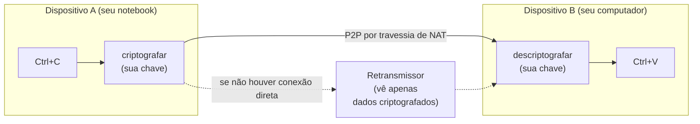
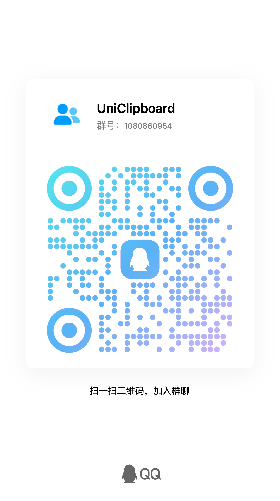
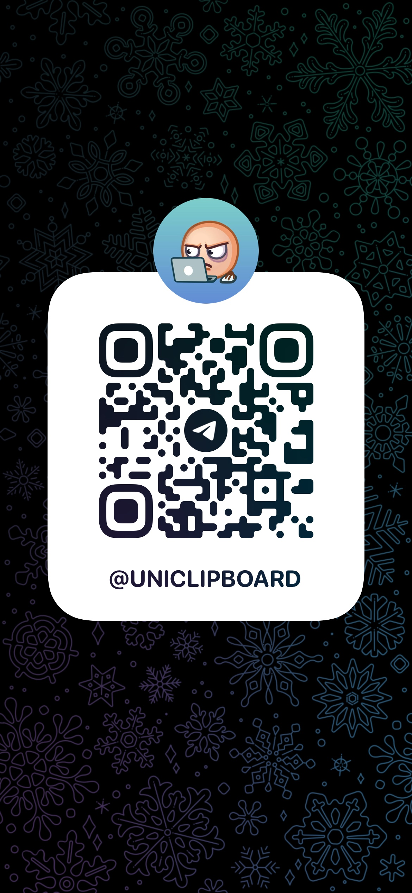

<!-- Translation of README.md; keep commands, links, and section coverage in sync. -->

<div align="center">
  <h1>UniClipboard</h1>
  <a href="https://github.com/UniClipboard/UniClipboard/releases">
    
  </a>
  <a href="https://github.com/UniClipboard/UniClipboard/releases">
    
  </a >
  <a href="https://github.com/UniClipboard/UniClipboard/releases">
    
  </a>
  <a href="#mobile-companion-lan">
    
  </a>
  <a href="#mobile-companion-lan">
    
  </a>

  <div>
    <a href="./LICENSE">
      
    </a >
    <a href="https://github.com/UniClipboard/UniClipboard/releases">
      
    </a >
    <a href="https://codecov.io/gh/UniClipboard/UniClipboard" >
      
    </a>
  </div>

</div>

<p align="center"><a href="./README.md">English</a> | <a href="./README_ZH.md">简体中文</a> | <a href="./README_ZH_TW.md">繁體中文</a> | <a href="./README_JA.md">日本語</a> | <a href="./README_RU.md">Русский</a> | Português (Brasil)</p>
<p align="center"><a href="./ABOUT.md">Quem mantém este projeto? (Sobre o projeto e confiança, em inglês)</a></p>

<a id="project-overview"></a>

## Visão geral

> **Copie em um dispositivo. Cole em outro — até pela internet.**
>
> Sem conta na nuvem. Sem servidores de terceiros. O conteúdo da área de transferência nunca sai dos seus dispositivos em um formato que outras pessoas possam ler.

O UniClipboard é uma ferramenta de área de transferência que **prioriza a privacidade**.
Ele mantém um histórico criptografado e pesquisável de tudo o que você copia, permite recuperar itens instantaneamente pelo painel rápido e sincroniza textos, imagens e arquivos entre dispositivos, na mesma rede Wi-Fi ou em redes diferentes. O conteúdo usa criptografia de ponta a ponta durante a transmissão e permanece criptografado no armazenamento. A descriptografia acontece apenas nos seus dispositivos; os retransmissores e a rede intermediária veem somente dados criptografados.

<p align="center">
  
</p>

<p align="center">
  <video src="https://github.com/user-attachments/assets/367c7f45-579a-49b7-bc96-9ccc25cf5ad0" controls muted playsinline width="800"></video>
  <br/>
  <em>Computador ↔ computador — sincronização bidirecional da área de transferência em tempo real.</em>
</p>

<details>
  <summary><strong>Demonstração no celular</strong> — envie uma captura de tela do celular para o computador. (Clique para expandir.)</summary>
  <p align="center">
    <video src="https://github.com/user-attachments/assets/29f4bf5d-8996-4602-8784-067fb919c671" controls muted playsinline width="800"></video>
  </p>
</details>

> [!IMPORTANT]
> **Vai atualizar da versão 0.19.x?** A versão 1.0 é uma atualização incompatível: os dados locais são convertidos para um novo formato, sem possibilidade de voltar à versão 0.19. Todos os dispositivos precisam executar a versão 1.0 e ser pareados novamente para retomar a sincronização. Leia o [guia de atualização de 0.19 para 1.0](https://docs.uniclipboard.app/migration/upgrade-0-19-to-v1) antes de atualizar.

<a id="table-of-contents"></a>

## Índice

- [Recursos](#features)
- [Instalação](#installation)
  - [Baixar das versões publicadas](#download-from-releases)
  - [Instalação com um comando (Linux / macOS)](#one-line-install-script-linux--macos)
  - [Linux](#linux)
  - [Homebrew (macOS)](#homebrew-macos)
  - [Atualização da versão 0.19.x](#upgrading-from-019x)
  - [Compilar a partir do código-fonte](#build-from-source)
- [Como usar](#usage)
  - [Primeiro dispositivo: criar um espaço](#first-device-create-a-space)
  - [Adicionar dispositivos por convite](#adding-more-devices-join-via-invitation)
  - [Conectar um celular](#mobile-companion-lan)
  - [Páginas principais](#main-pages)
- [Recursos avançados](#advanced-features)
  - [Como funciona](#how-it-works)
  - [Ferramenta de linha de comando](#command-line-tool)
  - [Privacidade e segurança](#privacy--security)
- [Perguntas frequentes](#faq)
- [Como contribuir](#contributing)
- [Licença](#license)
- [Agradecimentos](#acknowledgments)
- [Comunidade](#community)

<a id="features"></a>

## Recursos

- **Aplicativos para Windows, macOS e Linux**: instaladores nativos para x86_64 e ARM64 (Apple Silicon / Intel no macOS), além da CLI independente `uniclip`.
- **Pesquisa local de texto completo**: pesquise rapidamente todo o histórico, com sugestões e preenchimento pelo teclado. O próprio índice de pesquisa permanece criptografado no disco.
- **Painel rápido**: uma sobreposição acionada por atalho, com prévias de textos, links, imagens, código e arquivos. Em ambientes Linux sem atalhos globais, ele pode ser aberto por um atalho na área de trabalho.
- **Sincronização entre redes**: os computadores se conectam diretamente na mesma rede ou pela internet, com travessia automática de NAT. Quando a conexão direta não é possível, usam retransmissão criptografada. Você também pode adicionar seus próprios retransmissores.
- **Espaços criptografados**: os dispositivos entram em um espaço compartilhado com um código de convite de curta duração e a frase secreta do espaço. Sem conta na nuvem e sem e-mail.
- **Textos, imagens e arquivos**: copie em um dispositivo e cole em outro. Arquivos grandes são transmitidos em fluxo; transferências recebidas continuam após reiniciar o aplicativo, e transferências de vários itens mostram o progresso combinado e podem ser canceladas.
- **Controle por dispositivo**: escolha os tipos de conteúdo enviados e recebidos por cada dispositivo pareado, pause toda a sincronização ou apenas a automática separadamente (o envio manual continua disponível) e ative ou desative a sincronização por dispositivo na bandeja. Um dispositivo que volta a ficar on-line recebe o último item que perdeu.
- **Linha de comando**: `uniclip` permite configurar, parear, enviar, receber e gerenciar membros sem interface gráfica — ideal para terminais, SSH, scripts e servidores.
- **Gerenciamento de vários dispositivos**: veja o estado das conexões, ajuste as preferências individuais e remova um dispositivo perdido a partir de outro dispositivo pareado.
- **Atualização e recuperação seguras**: os dados locais recebem backup automático antes das atualizações. Se a chave guardada pelo sistema for perdida, a frase secreta original do espaço permite recuperar o acesso.
- **Aplicativos móveis**: o [UniClipboard para iOS e Android](https://github.com/UniClipboard/UniClip) se conecta ao computador. Veja [Conectar um celular](#mobile-companion-lan).
- **Interface em vários idiomas**: inglês, chinês simplificado, chinês tradicional, japonês, russo e português do Brasil.

<a id="installation"></a>

## Instalação

<!-- package-manager-versions:start -->
Instale pelo gerenciador de pacotes de sua preferência ou escolha uma opção de download abaixo. Os selos de versão levam à página do pacote publicado.

| Plataforma | Gerenciador de pacotes | Versão atual | Comando de instalação |
| --- | --- | --- | --- |
| macOS | Homebrew | [](https://formulae.brew.sh/cask/uniclipboard) | `brew install --cask uniclipboard` |
| Windows | WinGet | [](https://github.com/microsoft/winget-pkgs/tree/master/manifests/u/UniClipboard/UniClipboard) | `winget install --id UniClipboard.UniClipboard -e` |
| Windows | Scoop | [](https://github.com/ScoopInstaller/Extras/blob/HEAD/bucket/uniclipboard.json) | `scoop install extras/uniclipboard` |
| Windows | Chocolatey | [](https://community.chocolatey.org/packages/uniclipboard) | `choco install uniclipboard` |
| Arch Linux | AUR | [](https://aur.archlinux.org/packages/uniclipboard-git) | `yay -S uniclipboard-git` |
| Linux | Snap | [](https://snapcraft.io/uniclipboard) | `sudo snap install uniclipboard` |
| macOS / Windows / Linux | npm (CLI) | [](https://www.npmjs.com/package/@uniclipboard/cli) | `npm install -g @uniclipboard/cli` |
| Linux | Flathub | [](https://flathub.org/apps/app.uniclipboard.desktop) | Ainda não publicado |

O Scoop precisa do repositório Extras (`scoop bucket add extras`). O pacote do AUR acompanha a branch main. O aplicativo ainda não foi publicado no Flathub.

<details>
<summary>Outros canais e detalhes das versões</summary>

As instruções para COPR e o Nix flake experimental estão em [Linux](#linux); a seção [Homebrew](#homebrew-macos) também apresenta o tap do projeto e a CLI. Consulte o [estado completo dos canais](https://github.com/UniClipboard/UniClipboard/blob/package-status/status.json) para ver pré-lançamentos e outras fontes de pacotes. O cache pode atrasar a atualização dos selos do Shields.io.

</details>
<!-- package-manager-versions:end -->

<a id="download-from-releases"></a>

### Baixar das versões publicadas

Baixe a versão mais recente em [GitHub Releases](https://github.com/UniClipboard/UniClipboard/releases/latest):

| Plataforma | Pacotes |
| --- | --- |
| macOS | `.dmg` para Apple Silicon e Intel |
| Windows | Instalador (`-setup.exe`) e `.zip` portátil para x86_64 e ARM64 |
| Linux | `.deb`, `.rpm` e `.AppImage` para x86_64 e aarch64 |
| Apenas CLI | Arquivos `uniclipboard-cli-*` para macOS, Linux (musl) e Windows x86_64 |

Cada versão inclui assinaturas `.sig` e um arquivo `SHA256SUMS.txt` assinado para verificação.

<a id="one-line-install-script-linux--macos"></a>

### Instalação com um comando (Linux / macOS)

Não quer escolher um pacote manualmente? Um comando resolve:

```bash
curl -fsSL https://uniclipboard.app/install.sh | bash
```

O script instala a versão estável mais recente e identifica automaticamente o sistema e a CPU:

- **macOS** — baixa `.app.tar.gz`, extrai e move `UniClipboard.app` para `/Applications`. Usa `sudo` se o diretório não permitir escrita; passe `--prefix "$HOME/Applications"` para instalar no diretório do usuário.
- **Linux** — com sudo, instala o `.deb` em sistemas baseados em apt ou usa o COPR nos baseados em dnf (no Ubuntu 20.04, usa Snap). Caso contrário, instala AppImage em `~/.local/bin` e registra um arquivo `.desktop`, sem precisar de root.

Opções comuns:

```bash
# Pin a specific version
curl -fsSL https://uniclipboard.app/install.sh | bash -s -- --version v1.0.1

# Force AppImage (rootless even when sudo is available)
curl -fsSL https://uniclipboard.app/install.sh | bash -s -- --format appimage
```

Para desinstalar, use o script correspondente:

```bash
# Remove the app only, keep data and config
curl -fsSL https://raw.githubusercontent.com/UniClipboard/UniClipboard/main/scripts/uninstall.sh | bash

# Full wipe — also removes data directories, config, and cache
curl -fsSL https://raw.githubusercontent.com/UniClipboard/UniClipboard/main/scripts/uninstall.sh | bash -s -- --purge

# Preview what would be removed without deleting anything
curl -fsSL https://raw.githubusercontent.com/UniClipboard/UniClipboard/main/scripts/uninstall.sh | bash -s -- --dry-run
```

> As atualizações seguem as mesmas regras dos downloads manuais abaixo: instalações `.deb` / `.rpm` / COPR / Snap são atualizadas pelo gerenciador de pacotes, não pelo aplicativo. AppImage no Linux e `.app` no macOS são atualizados pelo próprio aplicativo.

<a id="linux"></a>

### Linux

Cada versão inclui `.deb`, `.rpm` e `.AppImage` para `x86_64` e `aarch64`.

**Fedora / RHEL / openSUSE — via COPR (recomendado, com atualizações automáticas)**

```bash
sudo dnf copr enable mkdir700/uniclipboard         # stable; mkdir700/uniclipboard-alpha for pre-releases
sudo dnf install uniclipboard
```

Depois de habilitar o repositório, `sudo dnf upgrade` obterá novas versões automaticamente.

**Snap**

```bash
sudo snap install uniclipboard
```

**Nix (x86_64 e aarch64, experimental)**

```bash
nix run github:UniClipboard/UniClipboard          # try it
nix profile add github:UniClipboard/UniClipboard  # install (older Nix: nix profile install)
```

É necessário habilitar os recursos experimentais `nix-command` e `flakes`. O flake reempacota o `.deb` publicado e atualmente fixa um pré-lançamento. Consulte [`packaging/nix/README.md`](packaging/nix/README.md) para configuração do NixOS, limitações conhecidas e estado da validação. Atualize pelo Nix, não pelo aplicativo, e não use a opção interna de iniciar ao entrar na sessão em uma instalação Nix.

**Ou baixe um .rpm / .deb / AppImage individual na página Releases:**

```bash
# Debian / Ubuntu
sudo dpkg -i UniClipboard_<version>_amd64.deb
sudo apt-get install -f                                 # resolve missing deps if any

# Fedora / RHEL / openSUSE (one-shot, no COPR)
sudo dnf install ./UniClipboard-<version>-1.x86_64.rpm

# AppImage (any distro)
chmod +x UniClipboard_<version>_amd64.AppImage
./UniClipboard_<version>_amd64.AppImage
```

> Instalações por COPR / Snap / rpm / deb não se atualizam por dentro do aplicativo: use o gerenciador de pacotes. No Linux, o atualizador interno é destinado ao AppImage.

<a id="homebrew-macos"></a>

### Homebrew (macOS)

No macOS, instale pelo tap oficial [`UniClipboard/homebrew-tap`](https://github.com/UniClipboard/homebrew-tap):

```bash
brew tap UniClipboard/tap

# Homebrew 6.0+ requires you to trust third-party taps before it will load
# their formulae/casks. Skip this and you'll hit
# "Refusing to load ... from untrusted tap". It only needs to run once.
brew trust UniClipboard/tap

# Desktop app (.app bundle)
brew install --cask uniclipboard

# CLI only — installs the `uniclip` command
brew install uniclipboard
```

Também é possível instalar diretamente sem adicionar o tap antes, mas ainda é preciso marcá-lo como confiável uma vez:

```bash
brew trust UniClipboard/tap                          # Homebrew 6.0+, one-time
brew install --cask UniClipboard/tap/uniclipboard    # GUI
brew install UniClipboard/tap/uniclipboard           # CLI
```

O cask e a formula podem coexistir: instale ambos se quiser a interface gráfica e o comando `uniclip`.

<a id="upgrading-from-019x"></a>

### Atualização da versão 0.19.x

A versão 1.0 converte os dados locais para um novo formato de armazenamento e proteção e usa um novo esquema de pareamento:

- Atualize por cima da instalação existente usando o mesmo método. O histórico recebe backup automático na primeira execução, que pode demorar mais.
- Não é possível voltar à versão 0.19 depois disso, e dispositivos nas versões 0.19 e 1.0 não sincronizam entre si.
- Os pareamentos antigos são apagados. Quando todos os dispositivos estiverem na versão 1.0, faça o pareamento novamente na página **Dispositivos**.

Veja o [guia de atualização de 0.19 para 1.0](https://docs.uniclipboard.app/migration/upgrade-0-19-to-v1) para a ordem recomendada, locais de backup e procedimentos de recuperação.

<a id="build-from-source"></a>

### Compilar a partir do código-fonte

Pré-requisitos: a toolchain Rust fixada em `rust-toolchain.toml`, [Bun](https://bun.sh), [Go](https://go.dev) (versão em `apps/gui-go/go.mod`) e os [pré-requisitos do Wails v3](https://v3alpha.wails.io/getting-started/installation/) para seu sistema. O comando de desenvolvimento `bun wails:dev` funciona no macOS e no Windows.

```bash
git clone https://github.com/UniClipboard/UniClipboard.git
cd UniClipboard

# Install dependencies
bun install

# Start development mode (isolated `dev` profile, so it doesn't touch an installed app's data)
bun wails:dev

# Build a local macOS app bundle
apps/gui-go/build.sh
```

A estrutura do pacote está descrita em `apps/gui-go/README.md`. Veja [CONTRIBUTING.md](./CONTRIBUTING.md), em inglês, para desenvolvimento com vários dispositivos, testes e convenções do projeto.

<a id="usage"></a>

## Como usar

<a id="first-device-create-a-space"></a>

### Primeiro dispositivo: criar um espaço

1. Abra o aplicativo, escolha **Este é meu primeiro dispositivo** e clique em **Criar novo espaço**.
2. Defina uma frase secreta de criptografia. Ela protege todos os dados do espaço e será necessária para adicionar dispositivos, por isso guarde-a com segurança.
3. Pronto. O conteúdo copiado é armazenado de forma criptografada nesse espaço.

<a id="adding-more-devices-join-via-invitation"></a>

### Adicionar dispositivos por convite

1. Em um dispositivo existente, abra **Dispositivos** e clique em **Convidar dispositivo** para gerar um código de curta duração.
2. No novo dispositivo, escolha **Já uso o UniClipboard em outro lugar** → **Entrar por pareamento** e informe o código de convite e a frase secreta do espaço.
3. Assim que o pareamento for confirmado, o dispositivo entra no espaço e a sincronização começa automaticamente.

> Já terminou a configuração e quer mudar de espaço? Use **Entrar em outro espaço** na página Dispositivos ou execute `uniclip space join --switch` na CLI. O histórico local é migrado para o novo espaço. Sem `--switch`, `uniclip space join` faz um novo pareamento não destrutivo, sem trocar de espaço.

### Conectar um celular <a id="mobile-companion-lan"></a>

O **[aplicativo móvel UniClipboard](https://github.com/UniClipboard/UniClip)** atende **iOS** ([beta público no TestFlight](https://testflight.apple.com/join/nyNQ8dQe)) e **Android** ([downloads de APK](https://github.com/UniClipboard/UniClip/releases/latest)). No computador, abra **Dispositivos** e clique no ícone de telefone para abrir **Conectar celular**, que oferece dois métodos:

- **Sincronização normal** (padrão) — modo de compatibilidade HTTP. O daemon do computador executa um pequeno serviço HTTP compatível com SyncClipboard; a janela registra o telefone e mostra um QR code com endereço e credenciais de uso único para o aplicativo ler.
- **Conexão de dispositivo (experimental)** — o telefone entra no espaço criptografado por um código de convite, como outro computador.

Limitações da sincronização normal:

- **Não é P2P** — o telefone é um cliente HTTP comum, sem travessia de NAT ou retransmissão. Funciona na rede local; para outras redes, use um [nó de servidor sem interface gráfica](https://docs.uniclipboard.app/guides/self-host-server-node) com HTTPS público ou uma rede Tailscale / VPN.
- **HTTP sem criptografia + Basic Auth no serviço** — habilite apenas em redes confiáveis ou use um proxy reverso com TLS.
- **O telefone não é membro do espaço** — não recebe ID de nó e não acessa o banco criptografado do histórico.
- **Sem sincronização silenciosa em segundo plano no iOS** — o sistema não oferece um mecanismo geral de monitoramento da área de transferência em segundo plano. O aplicativo sincroniza em primeiro plano ou por extensões de teclado e compartilhamento. Veja [FAQ sobre sincronização em segundo plano no iOS](https://docs.uniclipboard.app/help/faq#why-cant-the-ios-app-sync-clipboard-silently-in-the-background-like-the-desktop).

> ⚠️ Se o TestFlight mostrar erro de certificado ou o botão **Instalar** ficar carregando sem parar, desative temporariamente seu proxy / VPN, incluindo regras globais, TUN e descriptografia HTTPS / MitM, para permitir conexão direta. Ative novamente após instalar.

Veja o [guia do aplicativo móvel](https://docs.uniclipboard.app/mobile) e o [guia de sincronização móvel no computador](https://docs.uniclipboard.app/core-features/mobile-sync) para o processo completo.

<a id="main-pages"></a>

### Páginas principais

- **Histórico** — histórico da área de transferência com pesquisa de texto completo, filtros e prévias detalhadas
- **Painel rápido** — sobreposição acionada por atalho para acessar o conteúdo rapidamente
- **Dispositivos** — convites, conexão de celulares, estado da conexão, controle individual de sincronização e troca ou recriação de espaços
- **Configurações** — geral, aparência, atalhos, painel rápido, sincronização, segurança, rede, armazenamento (incluindo backups de atualização) e informações do aplicativo

<a id="advanced-features"></a>

## Recursos avançados

<a id="how-it-works"></a>

### Como funciona



- **Pareamento**: um novo dispositivo entra com um código de convite de uso único e a frase secreta do espaço. Sem conta na nuvem nem e-mail.
- **Transporte**: conexão direta quando os dispositivos são acessíveis entre si, na mesma rede ou por travessia de NAT; caso contrário, retransmissão criptografada.
- **Criptografia**: a criptografia do conteúdo independe do transporte. Até um retransmissor mal-intencionado vê apenas dados criptografados.
- **Armazenamento**: histórico local, prévias e índice de pesquisa são criptografados em repouso.
- **Resiliência**: as conexões se recuperam automaticamente após mudanças de rede, suspensão ou desconexões breves. Também é possível atualizar a conexão de um dispositivo na página Dispositivos.

**Componentes.** O aplicativo tem três partes: a interface gráfica (Go/Wails + React), o daemon em segundo plano `uniclipd`, que sincroniza e armazena o conteúdo, e a CLI `uniclip`. A interface gráfica e a CLI conversam com o mesmo daemon local por uma API HTTP / WebSocket de loopback e mostram o mesmo estado. Sincronização, criptografia e armazenamento ficam no repositório separado [UniClipboard Engine](https://github.com/UniClipboard/Engine), cuja revisão é fixada no `Cargo.toml` deste repositório.

<a id="command-line-tool"></a>

### Ferramenta de linha de comando

A CLI `uniclip` funciona com ou sem a interface gráfica, inclusive em servidores. Comandos comuns:

```bash
uniclip space init                          # Create a new encrypted space on this device
uniclip space invite                        # Generate a short-lived invitation code
uniclip space change-passphrase             # Change the space passphrase (unlocked, single-device space)
uniclip space join --code <code>            # Join a space (re-pair, non-destructive)
uniclip space join --switch --code <code>   # Switch to another space
uniclip space status                        # Inspect the active space and daemon
uniclip member list                         # List paired devices and presence
uniclip send "hello"                        # Send text to other devices
uniclip send ./report.pdf                   # Send an existing file
printf '%s\n' ./a.png './b c.pdf' | uniclip send --file   # Send paths from stdin
uniclip send --text report.pdf              # Force an existing filename to be sent as text
uniclip get                                 # Fetch the latest entry
uniclip get --wait                          # Wait for the next synced entry
uniclip get --copy                          # Copy the latest entry to this computer's clipboard
uniclip search "invoice"                    # Search clipboard history
uniclip run                                # Foreground daemon lifecycle
uniclip service start / restart / status / stop # User service lifecycle
```

Execute `uniclip --help` para a lista completa ou consulte a [referência da CLI](https://docs.uniclipboard.app/cli/reference).

<a id="privacy--security"></a>

### Privacidade e segurança

**O que coletamos** — dois canais anônimos e separados: diagnóstico (falhas, erros e logs com dados sensíveis removidos) e análise de uso (eventos como resultados de configuração e sincronização). Eles nunca incluem conteúdo da área de transferência, nomes ou caminhos de arquivos, frases secretas, chaves ou termos pesquisados. Ambos ficam ativos por padrão; o aviso da primeira execução permite desativá-los, e cada um pode ser controlado em **Configurações → Geral → Privacidade**. Os campos exatos estão em [Privacidade e coleta de dados](https://docs.uniclipboard.app/core-features/privacy).

**O que um retransmissor pode ver** — bytes criptografados e metadados da conexão, como IDs dos pares de origem e destino. Ele não consegue descriptografar seu conteúdo.

**O que fica no disco** — um banco SQLite e um índice de pesquisa criptografados. Texto, títulos, prévias, tags e nomes de arquivos são criptografados antes da gravação.

**Se perder um dispositivo** — remova-o de outro dispositivo pareado. Os demais param de enviar novos conteúdos para ele.

**Você pode auditar** — o aplicativo e o [Engine](https://github.com/UniClipboard/Engine), incluindo a criptografia, têm código aberto no GitHub.

<a id="cryptography-details"></a>

#### Detalhes da criptografia

- **XChaCha20-Poly1305 AEAD** protege o conteúdo com nonce aleatório de 24 bytes e chaves de 256 bits, oferecendo confidencialidade e verificações de integridade e autenticidade.
- **Argon2id** deriva o material de criptografia das chaves a partir da frase secreta do espaço (padrão: 128 MiB de memória, 3 iterações e 4 vias), dificultando ataques com GPU / ASIC.
- **Chaves em camadas**: as chaves do conteúdo ficam em um cofre criptografado por perfil. O armazenamento seguro do sistema (macOS Keychain, Windows Credential Manager e Linux Secret Service) guarda somente o material para desbloqueio automático. Se ele for perdido, a frase secreta original restaura o acesso.
- **Isolamento por espaço**: cada espaço tem suas próprias chaves.

<a id="faq"></a>

## Perguntas frequentes

<details>
  <summary><strong>Por que não usar apenas a Área de Transferência Universal do iCloud?</strong></summary>

Se você usa apenas dispositivos Apple, não precisa de histórico e confia totalmente na criptografia de ponta a ponta de código fechado da Apple, o iCloud atende. Ao adicionar Windows ou Linux, precisar pesquisar o histórico ou querer verificar a criptografia por conta própria, será necessário outro recurso.
</details>

<details>
  <summary><strong>Por que não usar uma solução de sincronização auto-hospedada, como ClipCascade?</strong></summary>

Uma solução auto-hospedada exige manter um servidor. O UniClipboard funciona de imediato: prioriza P2P direto e usa retransmissão criptografada somente como alternativa. Você não precisa operar infraestrutura.
</details>

<details>
  <summary><strong>Funciona na rede local sem retransmissor?</strong></summary>

Dispositivos acessíveis na mesma rede se conectam diretamente. **Configurações → Rede → Modo somente LAN** desativa completamente a alternativa por retransmissor; com esse modo, dispositivos em redes diferentes não conseguem se conectar. Veja no [FAQ](https://docs.uniclipboard.app/help/faq) quais acessos à internet ainda ocorrem nesse modo.
</details>

<details>
  <summary><strong>Onde meu histórico realmente fica armazenado?</strong></summary>

Somente nos seus dispositivos, criptografado em repouso. Nenhum servidor do UniClipboard recebe ou armazena o conteúdo da sua área de transferência.
</details>

<details>
  <summary><strong>Existe um aplicativo para celular?</strong></summary>

Sim — o **[aplicativo móvel UniClipboard](https://github.com/UniClipboard/UniClip)** atende iOS e Android. Ele usa sincronização normal por padrão e oferece um modo experimental de conexão de dispositivo para entrar no espaço por convite. Veja [Conectar um celular](#mobile-companion-lan).
</details>

<details>
  <summary><strong>Atualizei da versão 0.19 e meus dispositivos pararam de sincronizar. O que aconteceu?</strong></summary>

Isso é esperado: a versão 1.0 usa um novo esquema de pareamento, apaga os antigos e não permite parear dispositivos 0.19 e 1.0. Atualize todos para 1.0 e pareie novamente. Veja o [guia de atualização](https://docs.uniclipboard.app/migration/upgrade-0-19-to-v1).
</details>

<a id="contributing"></a>

## Como contribuir

Todas as formas de contribuição são bem-vindas! Leia [CONTRIBUTING.md](./CONTRIBUTING.md), em inglês, para configuração de desenvolvimento, estratégia de branches, convenções de commit e processo de PR.

Primeiros passos:

1. Faça um fork deste repositório.
2. Crie uma branch para sua alteração (`git checkout -b feature/amazing-feature`).
3. Faça commits seguindo as [convenções do projeto](./CONTRIBUTING.md#commit-conventions).
4. Envie a branch (`git push origin feature/amazing-feature`).
5. Abra um Pull Request para a branch `main`.

<a id="license"></a>

## Licença

Este projeto usa a licença AGPL-3.0. Veja [LICENSE](./LICENSE) para os detalhes.

<a id="acknowledgments"></a>

## Agradecimentos

- [Wails](https://wails.io) — framework de aplicativos multiplataforma
- [React](https://react.dev) — framework de desenvolvimento de interfaces
- [Rust](https://www.rust-lang.org) — linguagem segura e eficiente para o backend
- [iroh](https://www.iroh.computer) — rede P2P baseada em QUIC que permite conexões diretas entre redes e transferência de blobs
- [Tokio](https://tokio.rs) — runtime assíncrono que executa as operações de rede e de entrada e saída
- [shadcn/ui](https://ui.shadcn.com) — componentes combináveis construídos sobre Radix UI
- [Radix UI](https://www.radix-ui.com) — primitivas acessíveis sem estilo predefinido usadas na interface
- [Tailwind CSS](https://tailwindcss.com) — estilização de toda a interface baseada em classes utilitárias
- [SQLite](https://www.sqlite.org) — banco embutido que armazena o histórico localmente

<a id="community"></a>

## Comunidade

Converse com outros usuários e com a equipe de desenvolvimento:

<table align="center">
  <tr>
    <td align="center"><strong>Grupo do QQ</strong></td>
    <td align="center"><strong>Grupo do WeChat</strong></td>
    <td align="center"><strong>Grupo do Telegram</strong></td>
  </tr>
  <tr>
    <td align="center"></td>
    <td align="center"></td>
    <td align="center"><a href="https://t.me/uniclipboard"></a></td>
  </tr>
</table>

---

**Tem perguntas ou sugestões?** [Abra uma Issue](https://github.com/UniClipboard/UniClipboard/issues/new) ou entre em contato para conversar!
