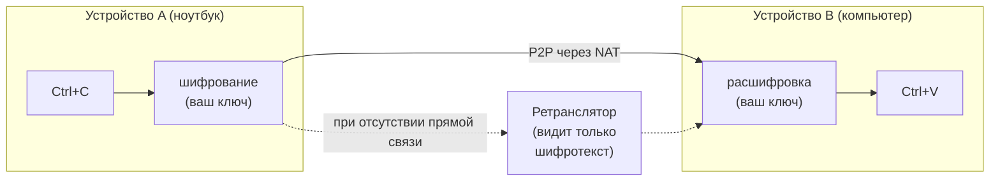

<!-- Translation of README.md; keep commands, links, and section coverage in sync. -->

<div align="center">
  <h1>UniClipboard</h1>
  <a href="https://github.com/UniClipboard/UniClipboard/releases">
    
  </a>
  <a href="https://github.com/UniClipboard/UniClipboard/releases">
    
  </a >
  <a href="https://github.com/UniClipboard/UniClipboard/releases">
    
  </a>
  <a href="#mobile-companion-lan">
    
  </a>
  <a href="#mobile-companion-lan">
    
  </a>

  <div>
    <a href="./LICENSE">
      
    </a >
    <a href="https://github.com/UniClipboard/UniClipboard/releases">
      
    </a >
    <a href="https://codecov.io/gh/UniClipboard/UniClipboard" >
      
    </a>
  </div>

</div>

<p align="center"><a href="./README.md">English</a> | <a href="./README_ZH.md">简体中文</a> | <a href="./README_ZH_TW.md">繁體中文</a> | <a href="./README_JA.md">日本語</a> | Русский | <a href="./README_PT_BR.md">Português (Brasil)</a></p>
<p align="center"><a href="./ABOUT.md">Кто поддерживает проект? (Об авторах и доверии, на английском)</a></p>

<a id="project-overview"></a>

## О проекте

> **Копируйте на одном устройстве. Вставляйте на другом — даже через интернет.**
>
> Без облачной учётной записи и сторонних серверов. Содержимое буфера обмена никогда не покидает ваши устройства в читаемом для посторонних виде.

UniClipboard — инструмент для работы с буфером обмена, в котором **конфиденциальность стоит на первом месте**.
Он сохраняет зашифрованную историю всего, что вы копируете, позволяет искать в ней и мгновенно открывать записи через быструю панель, а также синхронизирует текст, изображения и файлы между устройствами в одной сети Wi-Fi или в разных сетях. При передаче используется сквозное шифрование; на диске данные также остаются зашифрованными. Расшифровка происходит только на ваших устройствах, поэтому ретрансляторы и промежуточные сети видят лишь шифротекст.

<p align="center">
  
</p>

<p align="center">
  <video src="https://github.com/user-attachments/assets/367c7f45-579a-49b7-bc96-9ccc25cf5ad0" controls muted playsinline width="800"></video>
  <br/>
  <em>Компьютер ↔ компьютер — двусторонняя синхронизация буфера обмена в реальном времени.</em>
</p>

<details>
  <summary><strong>Мобильная версия в действии</strong> — отправка снимка экрана с телефона на компьютер. (Нажмите, чтобы раскрыть.)</summary>
  <p align="center">
    <video src="https://github.com/user-attachments/assets/29f4bf5d-8996-4602-8784-067fb919c671" controls muted playsinline width="800"></video>
  </p>
</details>

> [!IMPORTANT]
> **Обновляетесь с 0.19.x?** Версия 1.0 несовместима с предыдущей: локальные данные преобразуются в новый формат, после чего вернуться к 0.19 нельзя. Для возобновления синхронизации обновите все устройства до 1.0 и выполните сопряжение заново. Перед обновлением прочитайте [руководство по переходу с 0.19 на 1.0](https://docs.uniclipboard.app/migration/upgrade-0-19-to-v1).

<a id="table-of-contents"></a>

## Содержание

- [Возможности](#features)
- [Установка](#installation)
  - [Скачивание из Releases](#download-from-releases)
  - [Установка одной командой (Linux / macOS)](#one-line-install-script-linux--macos)
  - [Linux](#linux)
  - [Homebrew (macOS)](#homebrew-macos)
  - [Обновление с 0.19.x](#upgrading-from-019x)
  - [Сборка из исходного кода](#build-from-source)
- [Использование](#usage)
  - [Первое устройство: создание пространства](#first-device-create-a-space)
  - [Добавление устройств по приглашению](#adding-more-devices-join-via-invitation)
  - [Подключение телефона](#mobile-companion-lan)
  - [Основные страницы](#main-pages)
- [Дополнительные возможности](#advanced-features)
  - [Как это работает](#how-it-works)
  - [Командная строка](#command-line-tool)
  - [Конфиденциальность и безопасность](#privacy--security)
- [Частые вопросы](#faq)
- [Участие в разработке](#contributing)
- [Лицензия](#license)
- [Благодарности](#acknowledgments)
- [Сообщество](#community)

<a id="features"></a>

## Возможности

- **Приложения для Windows, macOS и Linux**: установочные пакеты для x86_64 и ARM64 (Apple Silicon / Intel на macOS), а также отдельный CLI `uniclip`.
- **Локальный полнотекстовый поиск**: быстрый поиск по всей истории с подсказками и дополнением с клавиатуры. Сам поисковый индекс также хранится на диске в зашифрованном виде.
- **Быстрая панель**: вызывается сочетанием клавиш и показывает текст, ссылки, изображения, код и файлы. Если окружение Linux не поддерживает глобальные сочетания клавиш, панель можно открыть ярлыком на рабочем столе.
- **Синхронизация между сетями**: прямое подключение в локальной сети или через интернет с автоматическим обходом NAT; при невозможности прямого соединения используется зашифрованная ретрансляция. Можно добавить собственные ретрансляторы.
- **Зашифрованные пространства**: устройства присоединяются к общему пространству по краткосрочному коду приглашения и парольной фразе пространства. Облачная учётная запись и электронная почта не нужны.
- **Текст, изображения и файлы**: копируйте на одном устройстве и вставляйте на другом. Большие файлы передаются потоково, входящая передача продолжается после перезапуска приложения, а для нескольких элементов показывается общий прогресс с возможностью отмены.
- **Управление синхронизацией каждого устройства**: выбирайте типы отправляемого и принимаемого содержимого, отдельно приостанавливайте всю или только автоматическую синхронизацию (ручная отправка остаётся доступной), включайте синхронизацию для отдельных устройств из меню в трее. Вернувшееся в сеть устройство получает последний пропущенный элемент.
- **Командная строка**: `uniclip` позволяет настраивать приложение, выполнять сопряжение, отправлять и получать данные, управлять участниками без графического интерфейса — в терминале, по SSH, в скриптах и на серверах.
- **Управление несколькими устройствами**: просматривайте состояние подключения, меняйте настройки синхронизации и удаляйте потерянное устройство с любого другого сопряжённого устройства.
- **Безопасное обновление и восстановление**: перед обновлением локальные данные автоматически копируются. Если сохранённый системой ключ потерян, доступ можно восстановить исходной парольной фразой пространства.
- **Мобильные приложения**: [UniClipboard для iOS и Android](https://github.com/UniClipboard/UniClip) подключается к компьютеру; см. [подключение телефона](#mobile-companion-lan).
- **Языки интерфейса**: английский, упрощённый и традиционный китайский, японский, русский и бразильский португальский.

<a id="installation"></a>

## Установка

<!-- package-manager-versions:start -->
Используйте предпочитаемый менеджер пакетов или скачайте приложение одним из способов ниже. Нажатие на значок версии открывает страницу опубликованного пакета.

| Платформа | Менеджер пакетов | Текущая версия | Команда установки |
| --- | --- | --- | --- |
| macOS | Homebrew | [](https://formulae.brew.sh/cask/uniclipboard) | `brew install --cask uniclipboard` |
| Windows | WinGet | [](https://github.com/microsoft/winget-pkgs/tree/master/manifests/u/UniClipboard/UniClipboard) | `winget install --id UniClipboard.UniClipboard -e` |
| Windows | Scoop | [](https://github.com/ScoopInstaller/Extras/blob/HEAD/bucket/uniclipboard.json) | `scoop install extras/uniclipboard` |
| Windows | Chocolatey | [](https://community.chocolatey.org/packages/uniclipboard) | `choco install uniclipboard` |
| Arch Linux | AUR | [](https://aur.archlinux.org/packages/uniclipboard-git) | `yay -S uniclipboard-git` |
| Linux | Snap | [](https://snapcraft.io/uniclipboard) | `sudo snap install uniclipboard` |
| macOS / Windows / Linux | npm (CLI) | [](https://www.npmjs.com/package/@uniclipboard/cli) | `npm install -g @uniclipboard/cli` |
| Linux | Flathub | [](https://flathub.org/apps/app.uniclipboard.desktop) | Пока не опубликовано |

Для Scoop требуется репозиторий Extras (`scoop bucket add extras`). Пакет AUR отслеживает ветку main. Во Flathub приложение пока не опубликовано.

<details>
<summary>Другие каналы и сведения о версиях</summary>

Инструкции для COPR и экспериментального Nix flake приведены в разделе [Linux](#linux); собственный tap проекта и CLI описаны в разделе [Homebrew](#homebrew-macos). Предварительные версии и другие источники пакетов доступны в [полном состоянии каналов](https://github.com/UniClipboard/UniClipboard/blob/package-status/status.json). Из-за кеширования значки Shields.io могут обновляться с задержкой.

</details>
<!-- package-manager-versions:end -->

<a id="download-from-releases"></a>

### Скачивание из Releases

Скачайте последнюю версию со страницы [GitHub Releases](https://github.com/UniClipboard/UniClipboard/releases/latest):

| Платформа | Пакеты |
| --- | --- |
| macOS | `.dmg` для Apple Silicon и Intel |
| Windows | Установщик (`-setup.exe`) и переносимый `.zip` для x86_64 и ARM64 |
| Linux | `.deb`, `.rpm` и `.AppImage` для x86_64 и aarch64 |
| Только CLI | Архивы `uniclipboard-cli-*` для macOS, Linux (musl) и Windows x86_64 |

Каждый выпуск содержит файлы подписей `.sig` и подписанный `SHA256SUMS.txt` для проверки.

<a id="one-line-install-script-linux--macos"></a>

### Установка одной командой (Linux / macOS)

Не хотите выбирать пакет вручную? Достаточно одной команды:

```bash
curl -fsSL https://uniclipboard.app/install.sh | bash
```

Скрипт устанавливает последнюю стабильную версию и автоматически определяет ОС и процессор:

- **macOS** — скачивает `.app.tar.gz`, распаковывает его и перемещает `UniClipboard.app` в `/Applications`. Если прав записи нет, использует `sudo`; для установки в каталог пользователя передайте `--prefix "$HOME/Applications"`.
- **Linux** — при наличии sudo устанавливает `.deb` в дистрибутивах на основе apt или использует COPR для dnf (на Ubuntu 20.04 — Snap). Иначе устанавливает AppImage в `~/.local/bin` и регистрирует `.desktop` без прав root.

Часто используемые параметры:

```bash
# Pin a specific version
curl -fsSL https://uniclipboard.app/install.sh | bash -s -- --version v1.0.1

# Force AppImage (rootless even when sudo is available)
curl -fsSL https://uniclipboard.app/install.sh | bash -s -- --format appimage
```

Удаление выполняется соответствующим скриптом:

```bash
# Remove the app only, keep data and config
curl -fsSL https://raw.githubusercontent.com/UniClipboard/UniClipboard/main/scripts/uninstall.sh | bash

# Full wipe — also removes data directories, config, and cache
curl -fsSL https://raw.githubusercontent.com/UniClipboard/UniClipboard/main/scripts/uninstall.sh | bash -s -- --purge

# Preview what would be removed without deleting anything
curl -fsSL https://raw.githubusercontent.com/UniClipboard/UniClipboard/main/scripts/uninstall.sh | bash -s -- --dry-run
```

> Обновление работает так же, как для скачанных вручную пакетов ниже: `.deb` / `.rpm` / COPR / Snap обновляются системным менеджером пакетов, а не из приложения. AppImage в Linux и `.app` в macOS обновляются внутри приложения.

<a id="linux"></a>

### Linux

В каждом выпуске есть `.deb`, `.rpm` и `.AppImage` для `x86_64` и `aarch64`.

**Fedora / RHEL / openSUSE — через COPR (рекомендуется, с автоматическим обновлением)**

```bash
sudo dnf copr enable mkdir700/uniclipboard         # stable; mkdir700/uniclipboard-alpha for pre-releases
sudo dnf install uniclipboard
```

После подключения репозитория команда `sudo dnf upgrade` будет получать новые выпуски.

**Snap**

```bash
sudo snap install uniclipboard
```

**Nix (x86_64 и aarch64, экспериментальная поддержка)**

```bash
nix run github:UniClipboard/UniClipboard          # try it
nix profile add github:UniClipboard/UniClipboard  # install (older Nix: nix profile install)
```

Нужны экспериментальные возможности `nix-command` и `flakes`. Flake перепаковывает опубликованный `.deb` и сейчас закреплён на предварительной версии. Настройка NixOS, известные ограничения и состояние проверки описаны в [`packaging/nix/README.md`](packaging/nix/README.md). Обновляйте через Nix, не через приложение; при установке через Nix также не используйте встроенный переключатель запуска при входе в систему.

**Или скачайте отдельный .rpm / .deb / AppImage со страницы Releases:**

```bash
# Debian / Ubuntu
sudo dpkg -i UniClipboard_<version>_amd64.deb
sudo apt-get install -f                                 # resolve missing deps if any

# Fedora / RHEL / openSUSE (one-shot, no COPR)
sudo dnf install ./UniClipboard-<version>-1.x86_64.rpm

# AppImage (any distro)
chmod +x UniClipboard_<version>_amd64.AppImage
./UniClipboard_<version>_amd64.AppImage
```

> Установки из COPR / Snap / rpm / deb не обновляются автоматически из приложения — используйте менеджер пакетов. В Linux встроенное обновление предназначено для AppImage.

<a id="homebrew-macos"></a>

### Homebrew (macOS)

На macOS можно установить приложение через официальный tap [`UniClipboard/homebrew-tap`](https://github.com/UniClipboard/homebrew-tap):

```bash
brew tap UniClipboard/tap

# Homebrew 6.0+ requires you to trust third-party taps before it will load
# their formulae/casks. Skip this and you'll hit
# "Refusing to load ... from untrusted tap". It only needs to run once.
brew trust UniClipboard/tap

# Desktop app (.app bundle)
brew install --cask uniclipboard

# CLI only — installs the `uniclip` command
brew install uniclipboard
```

Можно установить напрямую без предварительного добавления tap, но один раз разрешить доверие всё равно необходимо:

```bash
brew trust UniClipboard/tap                          # Homebrew 6.0+, one-time
brew install --cask UniClipboard/tap/uniclipboard    # GUI
brew install UniClipboard/tap/uniclipboard           # CLI
```

Cask и formula могут сосуществовать: установите оба, если нужны графическое приложение и команда `uniclip`.

<a id="upgrading-from-019x"></a>

### Обновление с 0.19.x

Версия 1.0 переводит локальные данные на новый формат хранения и защиты и использует новую схему сопряжения:

- Обновляйте поверх старой версии тем же способом установки. При первом запуске история автоматически копируется, поэтому он занимает больше времени.
- Вернуться к 0.19 после этого нельзя; устройства с 0.19 и 1.0 не могут синхронизироваться друг с другом.
- Старые сопряжения удаляются. Когда все устройства обновлены до 1.0, выполните сопряжение заново на странице **Устройства**.

Порядок действий, расположение копий и восстановление описаны в [руководстве по переходу с 0.19 на 1.0](https://docs.uniclipboard.app/migration/upgrade-0-19-to-v1).

<a id="build-from-source"></a>

### Сборка из исходного кода

Необходимы инструментарий Rust, закреплённый в `rust-toolchain.toml`, [Bun](https://bun.sh), [Go](https://go.dev) (версия в `apps/gui-go/go.mod`) и [зависимости Wails v3](https://v3alpha.wails.io/getting-started/installation/) для вашей ОС. Команда разработки `bun wails:dev` поддерживает macOS и Windows.

```bash
git clone https://github.com/UniClipboard/UniClipboard.git
cd UniClipboard

# Install dependencies
bun install

# Start development mode (isolated `dev` profile, so it doesn't touch an installed app's data)
bun wails:dev

# Build a local macOS app bundle
apps/gui-go/build.sh
```

Структура пакета описана в `apps/gui-go/README.md`. Разработка для нескольких устройств, тесты и правила проекта приведены в [CONTRIBUTING.md](./CONTRIBUTING.md) на английском.

<a id="usage"></a>

## Использование

<a id="first-device-create-a-space"></a>

### Первое устройство: создание пространства

1. Запустите приложение, выберите **Это моё первое устройство** и нажмите **Создать новое пространство**.
2. Задайте парольную фразу шифрования. Она защищает все данные пространства и нужна для добавления устройств, поэтому храните её надёжно.
3. Готово. Скопированное содержимое хранится в этом пространстве в зашифрованном виде.

<a id="adding-more-devices-join-via-invitation"></a>

### Добавление устройств по приглашению

1. На существующем устройстве откройте страницу **Устройства** и нажмите **Пригласить устройство**, чтобы создать краткосрочный код приглашения.
2. На новом устройстве выберите **Я уже использую UniClipboard на другом устройстве** → **Присоединиться через сопряжение** и введите код приглашения вместе с парольной фразой пространства.
3. После подтверждения сопряжения устройство присоединяется и синхронизация запускается автоматически.

> Хотите перейти в другое пространство после настройки? Выберите **Присоединиться к другому пространству** на странице устройств или выполните `uniclip space join --switch` в CLI. Локальная история буфера обмена переносится в новое пространство. Без `--switch` команда `uniclip space join` выполняет безопасное повторное сопряжение, не меняя пространство.

### Подключение телефона <a id="mobile-companion-lan"></a>

**[Мобильное приложение UniClipboard](https://github.com/UniClipboard/UniClip)** работает на **iOS** ([публичная бета TestFlight](https://testflight.apple.com/join/nyNQ8dQe)) и **Android** ([скачивание APK](https://github.com/UniClipboard/UniClip/releases/latest)). На компьютере откройте **Устройства** и нажмите значок телефона, чтобы открыть **Подключить телефон**. Доступны два способа:

- **Обычная синхронизация** (по умолчанию) — режим совместимости по HTTP. Настольный daemon запускает небольшой HTTP-сервис, совместимый с SyncClipboard; диалог регистрирует телефон и показывает QR-код с адресом и одноразовыми учётными данными для сканирования приложением.
- **Подключение устройства (экспериментально)** — телефон присоединяется к зашифрованному пространству по коду приглашения, как ещё один компьютер.

Ограничения обычной синхронизации:

- **Не P2P** — телефон является обычным HTTP-клиентом без обхода NAT и ретрансляции. Он работает в локальной сети; для других сетей используйте [серверный узел без графического интерфейса](https://docs.uniclipboard.app/guides/self-host-server-node) с публичным HTTPS либо Tailscale / VPN.
- **На стороне сервиса — открытый HTTP + Basic Auth**: включайте только в доверенной сети или разместите за обратным прокси с TLS.
- **Телефон не является участником пространства**: у него нет ID узла и доступа к зашифрованной базе истории.
- **На iOS нет незаметной фоновой синхронизации**: система не предоставляет общего фонового перехватчика буфера обмена, поэтому синхронизация выполняется при открытом приложении либо через расширения клавиатуры и общего доступа. См. [FAQ о фоновой синхронизации iOS](https://docs.uniclipboard.app/help/faq#why-cant-the-ios-app-sync-clipboard-silently-in-the-background-like-the-desktop).

> ⚠️ Если TestFlight сообщает об ошибке сертификата или кнопка **Установить** бесконечно показывает загрузку, временно отключите прокси / VPN (включая глобальные правила, TUN и расшифровку HTTPS / MitM), чтобы TestFlight подключился напрямую. После установки верните настройки.

Полная настройка описана в [руководстве мобильного приложения](https://docs.uniclipboard.app/mobile) и [руководстве мобильной синхронизации на компьютере](https://docs.uniclipboard.app/core-features/mobile-sync).

<a id="main-pages"></a>

### Основные страницы

- **История** — история буфера обмена с полнотекстовым поиском, фильтрами и подробным просмотром
- **Быстрая панель** — оверлей для быстрого доступа к буферу обмена сочетанием клавиш
- **Устройства** — приглашения, подключение телефонов, состояние соединений, индивидуальная синхронизация, смена и пересоздание пространств
- **Настройки** — общие параметры, внешний вид, сочетания клавиш, быстрая панель, синхронизация, безопасность, сеть, хранилище (включая копии перед обновлением), сведения о приложении

<a id="advanced-features"></a>

## Дополнительные возможности

<a id="how-it-works"></a>

### Как это работает



- **Сопряжение**: новое устройство присоединяется по одноразовому приглашению и парольной фразе пространства. Без облачной учётной записи и электронной почты.
- **Передача**: прямое подключение, если устройства доступны друг другу в одной сети или через NAT; иначе используется зашифрованный ретранслятор.
- **Шифрование**: шифрование содержимого независимо от транспорта — даже вредоносный ретранслятор видит только шифротекст.
- **Хранение**: локальная история, предпросмотры и поисковый индекс зашифрованы на диске.
- **Устойчивость**: соединения восстанавливаются после смены сети, сна или краткого разрыва. Подключение устройства можно обновить и вручную на странице устройств.

**Компоненты.** Настольное приложение состоит из GUI (Go/Wails + React), фонового daemon `uniclipd`, который синхронизирует и сохраняет буфер обмена, и CLI `uniclip`. GUI и CLI обращаются к одному локальному daemon по loopback HTTP / WebSocket API и потому показывают одно состояние. Синхронизация, шифрование и хранение реализованы в отдельном репозитории [UniClipboard Engine](https://github.com/UniClipboard/Engine); фиксированная ревизия указана в `Cargo.toml` этого репозитория.

<a id="command-line-tool"></a>

### Командная строка

CLI `uniclip` работает как с GUI, так и без него, например на сервере. Частые команды:

```bash
uniclip space init                          # Create a new encrypted space on this device
uniclip space invite                        # Generate a short-lived invitation code
uniclip space change-passphrase             # Change the space passphrase (unlocked, single-device space)
uniclip space join --code <code>            # Join a space (re-pair, non-destructive)
uniclip space join --switch --code <code>   # Switch to another space
uniclip space status                        # Inspect the active space and daemon
uniclip member list                         # List paired devices and presence
uniclip send "hello"                        # Send text to other devices
uniclip send ./report.pdf                   # Send an existing file
printf '%s\n' ./a.png './b c.pdf' | uniclip send --file   # Send paths from stdin
uniclip send --text report.pdf              # Force an existing filename to be sent as text
uniclip get                                 # Fetch the latest entry
uniclip get --wait                          # Wait for the next synced entry
uniclip get --copy                          # Copy the latest entry to this computer's clipboard
uniclip search "invoice"                    # Search clipboard history
uniclip run                                # Foreground daemon lifecycle
uniclip service start / restart / status / stop # User service lifecycle
```

Полный список доступен через `uniclip --help` и в [справочнике CLI](https://docs.uniclipboard.app/cli/reference).

<a id="privacy--security"></a>

### Конфиденциальность и безопасность

**Какие данные мы собираем** — два отдельных анонимных канала: диагностика (сбои, ошибки и обезличенные логи) и аналитика использования (события, например результаты настройки и синхронизации). Они никогда не содержат буфер обмена, имена и пути файлов, парольные фразы, ключи или поисковые запросы. Оба включены по умолчанию; уведомление при первом запуске позволяет отключить оба, а **Настройки → Общие → Конфиденциальность** — управлять каждым отдельно. Точные поля описаны в разделе [Конфиденциальность и сбор данных](https://docs.uniclipboard.app/core-features/privacy).

**Что видит ретранслятор** — зашифрованные байты и метаданные соединения: ID отправителя и получателя. Расшифровать содержимое он не может.

**Что хранится на диске** — зашифрованная база SQLite и поисковый индекс. Текст, заголовки, предпросмотры, теги и имена файлов шифруются до записи.

**Если устройство потеряно** — удалите его с другого сопряжённого устройства. Остальные устройства перестанут отправлять ему новые данные.

**Всё можно проверить** — настольное приложение и [Engine](https://github.com/UniClipboard/Engine), включая криптографию, доступны с открытым исходным кодом на GitHub.

<a id="cryptography-details"></a>

#### Криптографические подробности

- **XChaCha20-Poly1305 AEAD** шифрует содержимое буфера обмена со случайным nonce длиной 24 байта и ключами в 256 бит, обеспечивая конфиденциальность, целостность и подлинность.
- **Argon2id** выводит материал для шифрования ключей из парольной фразы пространства (по умолчанию: 128 MiB памяти, 3 итерации, 4 линии параллелизма), затрудняя взлом на GPU / ASIC.
- **Иерархия ключей**: ключи содержимого находятся в зашифрованном хранилище каждого профиля. Системное защищённое хранилище (macOS Keychain, Windows Credential Manager, Linux Secret Service) содержит только материал для автоматической разблокировки. Если он потерян, исходная парольная фраза позволяет восстановить доступ.
- **Изоляция пространств**: у каждого пространства собственные ключи.

<a id="faq"></a>

## Частые вопросы

<details>
  <summary><strong>Почему не использовать Универсальный буфер обмена iCloud?</strong></summary>

Если у вас только устройства Apple, история не нужна и вы полностью доверяете закрытому сквозному шифрованию Apple, iCloud подойдёт. Когда появляется Windows или Linux, нужен поиск по истории или возможность самостоятельно проверить шифрование, требуется другой инструмент.
</details>

<details>
  <summary><strong>Почему не использовать собственный сервер синхронизации, например ClipCascade?</strong></summary>

Собственный сервер нужно обслуживать. UniClipboard работает сразу: сначала прямое P2P-соединение, а зашифрованная ретрансляция — только если оно невозможно. Управлять инфраструктурой не требуется.
</details>

<details>
  <summary><strong>Работает ли приложение в локальной сети без ретранслятора?</strong></summary>

Устройства, доступные друг другу в одной сети, подключаются напрямую. **Настройки → Сеть → Только локальная сеть** полностью отключает переход на ретранслятор; при этом устройства в разных сетях не смогут соединиться. О том, какие обращения к интернету остаются в этом режиме, см. [FAQ](https://docs.uniclipboard.app/help/faq).
</details>

<details>
  <summary><strong>Где находится история буфера обмена?</strong></summary>

Только на ваших устройствах, в зашифрованном виде. Серверы UniClipboard никогда не получают и не хранят содержимое вашего буфера обмена.
</details>

<details>
  <summary><strong>Есть ли мобильное приложение?</strong></summary>

Да — **[UniClipboard для телефона](https://github.com/UniClipboard/UniClip)** поддерживает iOS и Android. По умолчанию используется обычная синхронизация; экспериментальное подключение устройства позволяет войти в пространство по приглашению. См. [подключение телефона](#mobile-companion-lan).
</details>

<details>
  <summary><strong>После обновления с 0.19 устройства перестали синхронизироваться. Что случилось?</strong></summary>

Это ожидаемо: в 1.0 новая схема сопряжения, поэтому старые связи удаляются, а устройства с 0.19 и 1.0 несовместимы. Обновите всё до 1.0 и выполните сопряжение заново. См. [руководство по обновлению](https://docs.uniclipboard.app/migration/upgrade-0-19-to-v1).
</details>

<a id="contributing"></a>

## Участие в разработке

Приветствуются любые формы участия! Подробности окружения разработки, ветвления, соглашений о коммитах и процесса PR приведены в [CONTRIBUTING.md](./CONTRIBUTING.md) на английском.

Быстрый старт:

1. Сделайте fork репозитория.
2. Создайте ветку для изменений (`git checkout -b feature/amazing-feature`).
3. Сделайте коммит по [правилам проекта](./CONTRIBUTING.md#commit-conventions).
4. Отправьте ветку (`git push origin feature/amazing-feature`).
5. Откройте Pull Request в ветку `main`.

<a id="license"></a>

## Лицензия

Проект распространяется по лицензии AGPL-3.0; подробности — в файле [LICENSE](./LICENSE).

<a id="acknowledgments"></a>

## Благодарности

- [Wails](https://wails.io) — кроссплатформенный фреймворк приложений
- [React](https://react.dev) — фреймворк пользовательского интерфейса
- [Rust](https://www.rust-lang.org) — безопасный и эффективный язык реализации серверной части
- [iroh](https://www.iroh.computer) — P2P-сеть на QUIC для прямых межсетевых соединений и передачи blob
- [Tokio](https://tokio.rs) — асинхронная среда выполнения для сетевых операций и ввода-вывода
- [shadcn/ui](https://ui.shadcn.com) — составные компоненты на основе Radix UI
- [Radix UI](https://www.radix-ui.com) — доступные примитивы без заданного оформления для интерфейса приложения
- [Tailwind CSS](https://tailwindcss.com) — утилитарные стили всего интерфейса
- [SQLite](https://www.sqlite.org) — встроенная база для локальной истории буфера обмена

<a id="community"></a>

## Сообщество

Общайтесь с другими пользователями и командой разработки:

<table align="center">
  <tr>
    <td align="center"><strong>Группа QQ</strong></td>
    <td align="center"><strong>Группа WeChat</strong></td>
    <td align="center"><strong>Группа Telegram</strong></td>
  </tr>
  <tr>
    <td align="center"></td>
    <td align="center"></td>
    <td align="center"><a href="https://t.me/uniclipboard"></a></td>
  </tr>
</table>

---

**Есть вопросы или предложения?** [Создайте Issue](https://github.com/UniClipboard/UniClipboard/issues/new) или свяжитесь с нами!
