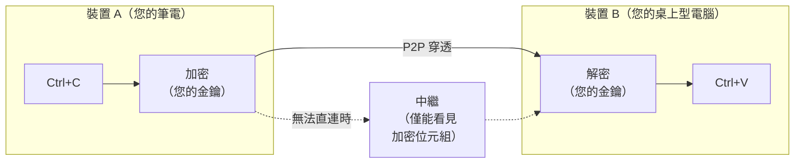

<!-- Translation of README.md; keep commands, links, and section coverage in sync. -->

<div align="center">
  <h1>UniClipboard</h1>
  <a href="https://github.com/UniClipboard/UniClipboard/releases">
    
  </a>
  <a href="https://github.com/UniClipboard/UniClipboard/releases">
    
  </a >
  <a href="https://github.com/UniClipboard/UniClipboard/releases">
    
  </a>
  <a href="#mobile-companion-lan">
    
  </a>
  <a href="#mobile-companion-lan">
    
  </a>

  <div>
    <a href="./LICENSE">
      
    </a >
    <a href="https://github.com/UniClipboard/UniClipboard/releases">
      
    </a >
    <a href="https://codecov.io/gh/UniClipboard/UniClipboard" >
      
    </a>
  </div>

</div>

<p align="center"><a href="./README.md">English</a> | <a href="./README_ZH.md">简体中文</a> | 繁體中文 | <a href="./README_JA.md">日本語</a> | <a href="./README_RU.md">Русский</a> | <a href="./README_PT_BR.md">Português (Brasil)</a></p>
<p align="center"><a href="./ABOUT.md">誰在維護這個專案？（關於本專案與信任說明，英文）</a></p>

<a id="project-overview"></a>

## 專案介紹

> **在一台裝置複製，在另一台貼上——即使隔著網際網路。**
>
> 不需要雲端帳號，也不依賴第三方伺服器。剪貼簿內容不會以他人可讀的形式離開您的裝置。

UniClipboard 是一款 **隱私優先** 的剪貼簿工具。
它會將您複製的內容保存為可搜尋的加密歷史紀錄，讓您透過快捷面板立即取用，並在同一個 Wi-Fi 或不同網路的裝置間同步文字、圖片和檔案。剪貼簿內容在傳輸時受到端對端加密保護，儲存時也維持加密；只有您的裝置會進行解密，因此中繼伺服器和傳輸路徑上的網路只能看到密文。

<p align="center">
  
</p>

<p align="center">
  <video src="https://github.com/user-attachments/assets/367c7f45-579a-49b7-bc96-9ccc25cf5ad0" controls muted playsinline width="800"></video>
  <br/>
  <em>電腦 ↔ 電腦——在兩台電腦之間即時雙向同步剪貼簿。</em>
</p>

<details>
  <summary><strong>行動版示範</strong>——將手機的螢幕擷取畫面傳到電腦。（點擊展開）</summary>
  <p align="center">
    <video src="https://github.com/user-attachments/assets/29f4bf5d-8996-4602-8784-067fb919c671" controls muted playsinline width="800"></video>
  </p>
</details>

> [!IMPORTANT]
> **從 0.19.x 升級？** 1.0 是不相容的升級：本機資料會轉換為新格式，之後無法降回 0.19。所有裝置都必須升級至 1.0 並重新配對，才能恢復同步。升級前請先閱讀 [0.19 → 1.0 升級指南](https://docs.uniclipboard.app/migration/upgrade-0-19-to-v1)。

<a id="table-of-contents"></a>

## 目錄

- [功能特色](#features)
- [安裝方式](#installation)
  - [從 Releases 下載](#download-from-releases)
  - [一行指令安裝（Linux / macOS）](#one-line-install-script-linux--macos)
  - [Linux](#linux)
  - [Homebrew (macOS)](#homebrew-macos)
  - [從 0.19.x 升級](#upgrading-from-019x)
  - [從原始碼建置](#build-from-source)
- [使用方式](#usage)
  - [第一台裝置：建立空間](#first-device-create-a-space)
  - [透過邀請新增裝置](#adding-more-devices-join-via-invitation)
  - [連接手機](#mobile-companion-lan)
  - [主要頁面](#main-pages)
- [進階功能](#advanced-features)
  - [運作方式](#how-it-works)
  - [命令列工具](#command-line-tool)
  - [隱私與安全](#privacy--security)
- [常見問題](#faq)
- [參與貢獻](#contributing)
- [授權條款](#license)
- [致謝](#acknowledgments)
- [社群](#community)

<a id="features"></a>

## 功能特色

- **Windows、macOS、Linux 桌面應用程式**：提供 x86_64 與 ARM64 原生安裝套件，macOS 支援 Apple Silicon 與 Intel，另有獨立的 `uniclip` 命令列工具。
- **本機全文搜尋**：透過建議和鍵盤補全功能快速搜尋全部歷史紀錄；搜尋索引本身也會加密儲存在磁碟上。
- **快捷面板**：以快捷鍵開啟浮動面板，預覽文字、連結、圖片、程式碼與檔案。Linux 桌面環境若不支援全域快捷鍵，可改用桌面捷徑開啟。
- **跨網路同步**：桌面裝置會在同一網路或透過網際網路自動嘗試 NAT 穿透及直接連線；無法直連時才使用加密中繼。您也可以新增自己的中繼伺服器。
- **加密空間**：使用短效邀請碼和空間通關密語，讓裝置加入同一個空間；不需要雲端帳號或電子郵件。
- **文字、圖片與檔案**：在一台裝置複製，在另一台貼上。大型檔案採串流傳輸，接收中的傳輸會在應用程式重新啟動後繼續，多個項目可合併顯示進度並取消。
- **逐一控制裝置同步**：選擇每台已配對裝置收發的內容類型，分別暫停所有同步或自動同步（仍可手動傳送），也能從系統匣切換各裝置的同步。裝置恢復連線後會收到錯過的最新一筆內容。
- **命令列工具**：`uniclip` 可在沒有圖形介面的環境完成設定、配對、傳送、接收與成員管理，適合終端機、SSH、指令碼與伺服器。
- **多裝置管理**：查看各裝置的連線狀態、調整個別同步偏好，並從其他已配對裝置移除遺失的裝置。
- **安全升級與復原**：升級前會自動備份本機資料。如果系統儲存的金鑰遺失，可用原本的空間通關密語復原。
- **行動應用程式**：[UniClipboard 行動版](https://github.com/UniClipboard/UniClip)支援 iOS 與 Android，可連接電腦，詳見[連接手機](#mobile-companion-lan)。
- **多語言介面**：英文、簡體中文、繁體中文、日文、俄文與巴西葡萄牙文。

<a id="installation"></a>

## 安裝方式

<!-- package-manager-versions:start -->
您可以透過套件管理員安裝，或選擇下方的直接下載方式。點擊版本徽章可開啟已發布套件的頁面。

| 平台 | 套件管理員 | 目前版本 | 安裝指令 |
| --- | --- | --- | --- |
| macOS | Homebrew | [](https://formulae.brew.sh/cask/uniclipboard) | `brew install --cask uniclipboard` |
| Windows | WinGet | [](https://github.com/microsoft/winget-pkgs/tree/master/manifests/u/UniClipboard/UniClipboard) | `winget install --id UniClipboard.UniClipboard -e` |
| Windows | Scoop | [](https://github.com/ScoopInstaller/Extras/blob/HEAD/bucket/uniclipboard.json) | `scoop install extras/uniclipboard` |
| Windows | Chocolatey | [](https://community.chocolatey.org/packages/uniclipboard) | `choco install uniclipboard` |
| Arch Linux | AUR | [](https://aur.archlinux.org/packages/uniclipboard-git) | `yay -S uniclipboard-git` |
| Linux | Snap | [](https://snapcraft.io/uniclipboard) | `sudo snap install uniclipboard` |
| macOS / Windows / Linux | npm (CLI) | [](https://www.npmjs.com/package/@uniclipboard/cli) | `npm install -g @uniclipboard/cli` |
| Linux | Flathub | [](https://flathub.org/apps/app.uniclipboard.desktop) | 尚未發布 |

Scoop 需要先加入 Extras 軟體來源（`scoop bucket add extras`）。AUR 追蹤 main 分支；Flathub 尚未發布。

<details>
<summary>其他管道與版本說明</summary>

COPR 與實驗性 Nix flake 的安裝方式見 [Linux](#linux)，專案軟體來源與命令列工具見 [Homebrew](#homebrew-macos)。預先發布版本及其他軟體來源可查看 [完整管道狀態](https://github.com/UniClipboard/UniClipboard/blob/package-status/status.json)。Shields.io 徽章可能因快取而延遲更新。

</details>
<!-- package-manager-versions:end -->

<a id="download-from-releases"></a>

### 從 Releases 下載

從 [GitHub Releases](https://github.com/UniClipboard/UniClipboard/releases/latest) 下載最新版本：

| 平台 | 套件 |
| --- | --- |
| macOS | Apple Silicon 與 Intel 的 `.dmg` |
| Windows | x86_64 與 ARM64 的安裝程式（`-setup.exe`）與可攜式 `.zip` |
| Linux | x86_64 與 aarch64 的 `.deb`、`.rpm`、`.AppImage` |
| 僅命令列工具 | macOS、Linux（musl）與 Windows x86_64 的 `uniclipboard-cli-*` 壓縮檔 |

每次發布都附有 `.sig` 簽章檔及已簽章的 `SHA256SUMS.txt`，可用於驗證。

<a id="one-line-install-script-linux--macos"></a>

### 一行指令安裝（Linux / macOS）

不想手動選擇套件？一行指令即可安裝：

```bash
curl -fsSL https://uniclipboard.app/install.sh | bash
```

指令碼預設安裝最新穩定版，並自動辨識作業系統與 CPU：

- **macOS**——下載 `.app.tar.gz`，解壓縮後將 `UniClipboard.app` 移到 `/Applications`。若沒有寫入權限會使用 `sudo`；也可加上 `--prefix "$HOME/Applications"` 安裝於使用者目錄。
- **Linux**——可使用 sudo 時，apt 系統會安裝 `.deb`，dnf 系統則使用 COPR（Ubuntu 20.04 使用 Snap）；否則將 AppImage 安裝到 `~/.local/bin` 並註冊 `.desktop`，不需要 root 權限。

常用選項：

```bash
# Pin a specific version
curl -fsSL https://uniclipboard.app/install.sh | bash -s -- --version v1.0.1

# Force AppImage (rootless even when sudo is available)
curl -fsSL https://uniclipboard.app/install.sh | bash -s -- --format appimage
```

解除安裝請使用對應的指令碼：

```bash
# Remove the app only, keep data and config
curl -fsSL https://raw.githubusercontent.com/UniClipboard/UniClipboard/main/scripts/uninstall.sh | bash

# Full wipe — also removes data directories, config, and cache
curl -fsSL https://raw.githubusercontent.com/UniClipboard/UniClipboard/main/scripts/uninstall.sh | bash -s -- --purge

# Preview what would be removed without deleting anything
curl -fsSL https://raw.githubusercontent.com/UniClipboard/UniClipboard/main/scripts/uninstall.sh | bash -s -- --dry-run
```

> 更新方式與下方的手動下載相同：`.deb` / `.rpm` / COPR / Snap 由系統套件管理員更新，不使用應用程式內建更新。Linux 的 AppImage 與 macOS 的 `.app` 則由應用程式內更新。

<a id="linux"></a>

### Linux

每次發布都包含 `x86_64` 與 `aarch64` 的 `.deb`、`.rpm`、`.AppImage`。

**Fedora / RHEL / openSUSE——透過 COPR（建議，可自動更新）**

```bash
sudo dnf copr enable mkdir700/uniclipboard         # stable; mkdir700/uniclipboard-alpha for pre-releases
sudo dnf install uniclipboard
```

啟用後，`sudo dnf upgrade` 會自動取得新版本。

**Snap**

```bash
sudo snap install uniclipboard
```

**Nix（x86_64 與 aarch64，實驗性）**

```bash
nix run github:UniClipboard/UniClipboard          # try it
nix profile add github:UniClipboard/UniClipboard  # install (older Nix: nix profile install)
```

這些指令需要啟用 `nix-command` 和 `flakes` 實驗性功能。此 flake 會重新封裝已發布的 `.deb`，目前固定在預先發布版本。NixOS 設定、已知限制及驗證狀態見 [`packaging/nix/README.md`](packaging/nix/README.md)。請透過 Nix 更新，不要使用應用程式內更新；透過 Nix 安裝時，也不要使用應用程式內的登入時自動啟動開關。

**也可以從 Releases 頁面單獨下載 .rpm / .deb / AppImage：**

```bash
# Debian / Ubuntu
sudo dpkg -i UniClipboard_<version>_amd64.deb
sudo apt-get install -f                                 # resolve missing deps if any

# Fedora / RHEL / openSUSE (one-shot, no COPR)
sudo dnf install ./UniClipboard-<version>-1.x86_64.rpm

# AppImage (any distro)
chmod +x UniClipboard_<version>_amd64.AppImage
./UniClipboard_<version>_amd64.AppImage
```

> 透過 COPR / Snap / rpm / deb 安裝的版本不會在應用程式內自動更新，請使用套件管理員。Linux 的內建更新是供 AppImage 使用。

<a id="homebrew-macos"></a>

### Homebrew (macOS)

macOS 可透過官方 tap [`UniClipboard/homebrew-tap`](https://github.com/UniClipboard/homebrew-tap) 安裝：

```bash
brew tap UniClipboard/tap

# Homebrew 6.0+ requires you to trust third-party taps before it will load
# their formulae/casks. Skip this and you'll hit
# "Refusing to load ... from untrusted tap". It only needs to run once.
brew trust UniClipboard/tap

# Desktop app (.app bundle)
brew install --cask uniclipboard

# CLI only — installs the `uniclip` command
brew install uniclipboard
```

也可以不先加入 tap，直接執行下列指令；仍須先將該 tap 設為信任一次：

```bash
brew trust UniClipboard/tap                          # Homebrew 6.0+, one-time
brew install --cask UniClipboard/tap/uniclipboard    # GUI
brew install UniClipboard/tap/uniclipboard           # CLI
```

cask 和 formula 可同時安裝；若需要圖形介面和 `uniclip` 指令，可兩者皆裝。

<a id="upgrading-from-019x"></a>

### 從 0.19.x 升級

1.0 會將本機資料轉換為新的儲存與保護格式，並採用新的配對方式：

- 請沿用相同方式覆蓋安裝。第一次啟動會自動備份歷史紀錄，因此耗時較長。
- 升級後無法降回 0.19；0.19 與 1.0 的裝置也無法互相同步。
- 升級時會清除舊配對。所有裝置都升至 1.0 後，請從 **裝置** 頁面重新配對。

建議的升級順序、備份位置和復原步驟，請參閱 [0.19 → 1.0 升級指南](https://docs.uniclipboard.app/migration/upgrade-0-19-to-v1)。

<a id="build-from-source"></a>

### 從原始碼建置

需求：`rust-toolchain.toml` 指定的 Rust 工具鏈、[Bun](https://bun.sh)、[Go](https://go.dev)（版本見 `apps/gui-go/go.mod`），以及適用於您作業系統的 [Wails v3 前置需求](https://v3alpha.wails.io/getting-started/installation/)。開發指令 `bun wails:dev` 支援 macOS 與 Windows。

```bash
git clone https://github.com/UniClipboard/UniClipboard.git
cd UniClipboard

# Install dependencies
bun install

# Start development mode (isolated `dev` profile, so it doesn't touch an installed app's data)
bun wails:dev

# Build a local macOS app bundle
apps/gui-go/build.sh
```

應用程式套件的結構見 `apps/gui-go/README.md`。多裝置開發、測試與專案慣例請參閱 [CONTRIBUTING.md](./CONTRIBUTING.md)（英文）。

<a id="usage"></a>

## 使用方式

<a id="first-device-create-a-space"></a>

### 第一台裝置：建立空間

1. 啟動應用程式，選擇 **這是我的第一台裝置**，再點擊 **建立新空間**。
2. 設定加密通關密語。它會保護空間中的所有資料，新增裝置時也需要使用，請妥善保存。
3. 完成。複製的內容會加密儲存在這個空間。

<a id="adding-more-devices-join-via-invitation"></a>

### 透過邀請新增裝置

1. 在現有裝置開啟 **裝置** 頁面，點擊 **邀請裝置** 以產生短效邀請碼。
2. 在新裝置選擇 **我已在其他地方使用 UniClipboard** → **透過配對加入**，輸入邀請碼和空間通關密語。
3. 配對確認後，裝置就會加入空間並自動開始同步。

> 已完成設定，想換到另一個空間？請使用裝置頁面的 **加入其他空間**，或在命令列執行 `uniclip space join --switch`；本機剪貼簿歷史紀錄會移轉到新空間。未加上 `--switch` 的 `uniclip space join` 只會執行非破壞性的重新配對，不會切換空間。

### 連接手機 <a id="mobile-companion-lan"></a>

**[UniClipboard 行動應用程式](https://github.com/UniClipboard/UniClip)** 支援 **iOS**（[TestFlight 公開測試](https://testflight.apple.com/join/nyNQ8dQe)）和 **Android**（[下載 APK](https://github.com/UniClipboard/UniClip/releases/latest)）。在電腦開啟 **裝置**，點擊手機圖示以開啟 **連接手機**，提供兩種方式：

- **一般同步**（預設）——HTTP 相容模式。桌面 daemon 會啟動與 SyncClipboard 相容的小型 HTTP 服務；對話框會註冊手機，並顯示包含位址與一次性認證資訊的 QR 碼，供應用程式掃描。
- **裝置連線（實驗性）**——手機像其他電腦一樣，透過邀請碼加入加密空間。

一般同步的限制：

- **不是 P2P**——手機只是 HTTP 用戶端，沒有 NAT 穿透或中繼功能，適用於區域網路。其他網路可使用[無圖形介面的伺服器節點](https://docs.uniclipboard.app/guides/self-host-server-node)（公開 HTTPS），或 Tailscale / VPN 虛擬網路。
- **服務接聽端為未加密 HTTP + Basic Auth**——僅在可信任網路啟用，或放在 TLS 反向代理後方。
- **手機不是空間成員**——不會取得節點 ID，也無法讀取加密的歷史紀錄資料庫。
- **iOS 無法無聲地在背景同步**——iOS 不提供通用的背景剪貼簿監控機制，因此僅能在應用程式處於前景時，或透過鍵盤與分享延伸功能同步。詳見 [FAQ：iOS 背景同步](https://docs.uniclipboard.app/help/faq#why-cant-the-ios-app-sync-clipboard-silently-in-the-background-like-the-desktop)。

> ⚠️ 如果 TestFlight 顯示憑證錯誤，或 **安裝** 按鈕一直轉圈，請暫時關閉代理伺服器／VPN（包含全域規則、TUN、HTTPS 解密／MitM），讓 TestFlight 直接連線；安裝完成後再開啟。

完整設定流程見[行動應用程式指南](https://docs.uniclipboard.app/mobile)與[桌面行動同步指南](https://docs.uniclipboard.app/core-features/mobile-sync)。

<a id="main-pages"></a>

### 主要頁面

- **歷史紀錄**——具有全文搜尋、篩選與詳細預覽的剪貼簿歷史紀錄
- **快捷面板**——透過快捷鍵開啟的浮動介面，快速存取剪貼簿
- **裝置**——邀請裝置、連接手機、查看連線狀態、管理逐一裝置同步，以及切換或重建空間
- **設定**——一般、外觀、快捷鍵、快捷面板、同步、安全、網路、儲存空間（含升級備份）及關於資訊

<a id="advanced-features"></a>

## 進階功能

<a id="how-it-works"></a>

### 運作方式



- **配對**：使用一次性邀請碼與空間通關密語讓新裝置加入，不需要雲端帳號或電子郵件。
- **傳輸**：裝置可互相連線時採直接連線，包括同一網路或跨網路 NAT 穿透；否則使用加密中繼。
- **加密**：內容加密獨立於傳輸方式，即使惡意中繼也只能看到密文。
- **儲存**：本機歷史紀錄、預覽及搜尋索引在儲存時都會加密。
- **復原能力**：網路切換、睡眠喚醒或短暫斷線後會自動恢復連線；也可在裝置頁面手動重新整理連線。

**組成。** 桌面應用程式包含三部分：圖形介面（Go/Wails + React）、負責同步與儲存剪貼簿的背景 daemon `uniclipd`，以及 `uniclip` 命令列工具。圖形介面與命令列透過回環 HTTP / WebSocket API 連到同一個本機 daemon，因此顯示相同狀態。同步、加密與儲存實作位於獨立的 [UniClipboard Engine](https://github.com/UniClipboard/Engine) 儲存庫，本儲存庫在 `Cargo.toml` 固定採用特定的提交版本。

<a id="command-line-tool"></a>

### 命令列工具

`uniclip` 不論是否啟動圖形介面都能運作，也適用於伺服器。常用指令如下：

```bash
uniclip space init                          # Create a new encrypted space on this device
uniclip space invite                        # Generate a short-lived invitation code
uniclip space change-passphrase             # Change the space passphrase (unlocked, single-device space)
uniclip space join --code <code>            # Join a space (re-pair, non-destructive)
uniclip space join --switch --code <code>   # Switch to another space
uniclip space status                        # Inspect the active space and daemon
uniclip member list                         # List paired devices and presence
uniclip send "hello"                        # Send text to other devices
uniclip send ./report.pdf                   # Send an existing file
printf '%s\n' ./a.png './b c.pdf' | uniclip send --file   # Send paths from stdin
uniclip send --text report.pdf              # Force an existing filename to be sent as text
uniclip get                                 # Fetch the latest entry
uniclip get --wait                          # Wait for the next synced entry
uniclip get --copy                          # Copy the latest entry to this computer's clipboard
uniclip search "invoice"                    # Search clipboard history
uniclip run                                # Foreground daemon lifecycle
uniclip service start / restart / status / stop # User service lifecycle
```

執行 `uniclip --help` 查看完整列表，或參閱 [CLI 參考文件](https://docs.uniclipboard.app/cli/reference)。

<a id="privacy--security"></a>

### 隱私與安全

**我們收集什麼**——兩個獨立、匿名的管道：診斷資訊（當機、錯誤與已遮蔽敏感內容的日誌），以及使用分析（例如設定與同步結果等產品事件）。兩者絕不包含剪貼簿內容、檔名或路徑、通關密語、金鑰或搜尋字詞。預設皆啟用；首次啟動提示可關閉兩者，也可在 **設定 → 一般 → 隱私** 中分別控制。確切欄位見[隱私與資料收集](https://docs.uniclipboard.app/core-features/privacy)。

**中繼能看到什麼**——加密位元組和連線中繼資料（來源／目的端點 ID），無法解密您的內容。

**磁碟上儲存什麼**——加密的 SQLite 資料庫與搜尋索引。剪貼簿文字、標題、預覽、標籤與檔名會在寫入前加密。

**如果裝置遺失**——從另一台已配對裝置將它移除，其他裝置便不再傳送新內容給它。

**可自行稽核**——桌面應用程式和 [Engine](https://github.com/UniClipboard/Engine) 的原始碼均公開於 GitHub，包括密碼學實作。

<a id="cryptography-details"></a>

#### 密碼學細節

- **XChaCha20-Poly1305 AEAD** 保護剪貼簿內容，使用 24 位元組隨機 nonce 與 256 位元金鑰，同時提供機密性、完整性與真實性驗證。
- **Argon2id** 從空間通關密語導出用來加密金鑰的材料，預設記憶體 128 MiB、3 次迭代、4 個平行處理通道，可抵抗 GPU / ASIC 破解。
- **分層金鑰**：內容金鑰位於個別設定檔的加密金鑰保管庫中。系統安全儲存空間（macOS Keychain、Windows Credential Manager、Linux Secret Service）只保存自動解鎖所需的材料；若遺失，可用原始空間通關密語復原存取。
- **逐一空間隔離**：每個空間都有自己的金鑰。

<a id="faq"></a>

## 常見問題

<details>
  <summary><strong>為什麼不直接使用 iCloud 通用剪貼簿？</strong></summary>

如果您只使用 Apple 裝置、不需要歷史紀錄，也完全信任 Apple 不公開原始碼的端對端加密，iCloud 就足夠。但若加入 Windows 或 Linux 電腦、需要可搜尋的歷史紀錄，或想自行驗證加密方式，就需要其他工具。
</details>

<details>
  <summary><strong>為什麼不自架剪貼簿同步服務，例如 ClipCascade？</strong></summary>

自架服務代表您得自行維護伺服器。UniClipboard 開箱即用，優先嘗試 P2P 直連，無法直連時才採加密中繼，不需要自行管理基礎設施。
</details>

<details>
  <summary><strong>沒有中繼時，可在區域網路內使用嗎？</strong></summary>

同一網路上可互相連線的裝置會直接連線，不經過中繼。**設定 → 網路 → 僅限區域網路模式** 可完全停用中繼備援；啟用後，不同網路的裝置便無法連線。此模式下仍會存取網際網路的項目見 [FAQ](https://docs.uniclipboard.app/help/faq)。
</details>

<details>
  <summary><strong>剪貼簿歷史紀錄到底存在哪裡？</strong></summary>

只會加密儲存在您的裝置上。UniClipboard 伺服器絕不接收或儲存您的剪貼簿內容。
</details>

<details>
  <summary><strong>有行動應用程式嗎？</strong></summary>

有，**[UniClipboard 行動版](https://github.com/UniClipboard/UniClip)** 支援 iOS 與 Android。預設以一般同步連接，也提供實驗性的裝置連線模式，透過邀請碼加入空間。詳見 [連接手機](#mobile-companion-lan)。
</details>

<details>
  <summary><strong>從 0.19 升級後，裝置無法同步了，發生什麼事？</strong></summary>

這是預期行為：1.0 採用新的配對方式，會清除舊配對，0.19 與 1.0 裝置也無法互相配對。請將所有裝置升級到 1.0 並重新配對。詳見 [升級指南](https://docs.uniclipboard.app/migration/upgrade-0-19-to-v1)。
</details>

<a id="contributing"></a>

## 參與貢獻

歡迎各種形式的貢獻！開發環境、分支策略、提交慣例和 PR 流程，請閱讀 [CONTRIBUTING.md](./CONTRIBUTING.md)（英文）。

快速開始：

1. Fork 此儲存庫。
2. 建立功能分支（`git checkout -b feature/amazing-feature`）。
3. 依照專案的[提交慣例](./CONTRIBUTING.md#commit-conventions)提交變更。
4. 推送分支（`git push origin feature/amazing-feature`）。
5. 向 `main` 分支開啟 Pull Request。

<a id="license"></a>

## 授權條款

本專案採用 AGPL-3.0 授權，詳見 [LICENSE](./LICENSE)。

<a id="acknowledgments"></a>

## 致謝

- [Wails](https://wails.io)——跨平台應用程式框架
- [React](https://react.dev)——前端使用者介面開發框架
- [Rust](https://www.rust-lang.org)——安全且高效的後端實作語言
- [iroh](https://www.iroh.computer)——以 QUIC 為基礎的 P2P 網路，提供跨網路直連與 blob 傳輸
- [Tokio](https://tokio.rs)——處理網路與輸入／輸出的非同步執行環境
- [shadcn/ui](https://ui.shadcn.com)——以 Radix UI 為基礎的可組合元件範本
- [Radix UI](https://www.radix-ui.com)——桌面介面的無預設樣式、具無障礙支援的基礎元件
- [Tailwind CSS](https://tailwindcss.com)——用於整個介面的工具類別優先樣式框架
- [SQLite](https://www.sqlite.org)——在本機儲存剪貼簿歷史紀錄的內嵌資料庫

<a id="community"></a>

## 社群

歡迎與其他使用者及開發團隊交流：

<table align="center">
  <tr>
    <td align="center"><strong>QQ 群組</strong></td>
    <td align="center"><strong>WeChat 群組</strong></td>
    <td align="center"><strong>Telegram 群組</strong></td>
  </tr>
  <tr>
    <td align="center"></td>
    <td align="center"></td>
    <td align="center"><a href="https://t.me/uniclipboard"></a></td>
  </tr>
</table>

---

**有問題或建議？** 歡迎[建立 Issue](https://github.com/UniClipboard/UniClipboard/issues/new)，或聯絡我們討論！
