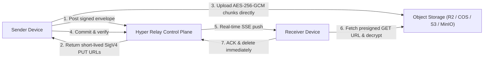

When paired devices are online and reachable directly, unic always **prefers direct P2P** with zero relay traffic. Only when a target device is temporarily offline or cold-starting (such as waking a mobile app from the background or sharing over cellular) does unic automatically use **Hybrid Relay (Hyper Relay)** to start sending with **zero wait** while waking P2P in the background.

<Callout>
Hybrid Relay is only for short-lived, end-to-end encrypted temporary staging (10-minute default TTL, deleted immediately after delivery confirmation). It is **not** a cloud clipboard history store. Neither the relay server nor object storage can read your plaintext, file names, MIME types, or source app names.
</Callout>

## Two Separate Relay Programs

The unic ecosystem has **two orthogonal, independently deployed** relay programs. Do not confuse them:

| Dimension | Tailcat P2P / DERP Relay | Hyper Hybrid Relay (`UniClipboard/relay`) |
|---|---|---|
| **Layer** | Transport / tunnel layer: assists `builtin.tailcat` with NAT traversal and real-time WireGuard packet forwarding | Application / chunk layer: zero-wait E2EE temporary chunk control plane + SSE push notifications |
| **Stores payloads?** | No — live online byte forwarding only; both peers must be online to complete the tunnel handshake | Yes — ciphertext chunks are staged in object storage via presigned URLs (10 min default TTL) and deleted on ACK |
| **Ciphertext data path** | Encrypted tunnel traffic transits the DERP node | **Direct-to-S3**: ciphertext chunks go directly between devices and S3/R2/COS/OSS/MinIO, **never through the relay server** |
| **Self-hosting boundary** | Owned by `builtin.tailcat`; completely decoupled from Hybrid Relay | Standalone HTTP service (Go container or Cloudflare Workers); can be self-hosted independently of or alongside DERP |

Unless otherwise noted, "Hybrid Relay" below refers to **Hyper Relay** (open-source repository: [UniClipboard/relay](https://github.com/UniClipboard/relay)).

## How It Works



- **Zero relay overhead when P2P is online**: If a peer already has an active P2P session, transfers go straight over P2P with zero HTTP relay requests.
- **Zero-wait offline fallback**: When a peer has no active P2P session and the payload fits within the per-transfer cap (official default **25 MB**), unic starts encrypted HTTPS upload immediately while asynchronously waking P2P reconnection.
- **Direct-to-S3 control/data split & geo-routed storage**: Official hosting uses a single global origin (`https://relay.uniclipboard.app`), keeping `relay_origin` and `mailbox_id` identical across borders and proxy switches. The control plane handles only small JSON messages, Ed25519 auth, SSE push, and short-lived AWS SigV4 presigned URLs, while object storage routes by region per transfer (**Tencent Cloud COS in mainland China, Cloudflare R2 overseas**) with transparent cross-region download. Self-hosted setups work with any S3-compatible bucket so even a 1 vCPU / 1 Mbps VM handles large transfers cleanly.
- **Mid-transfer P2P handoff for large payloads**: Payloads larger than 2 MiB are split into 1 MiB independently encrypted chunks. If P2P comes online mid-upload, both devices reconcile received chunks via bitmaps, stream only the remaining chunks over P2P into the same assembly buffer, and clean up cloud chunks once committed. If P2P drops mid-handoff, the transfer seamlessly falls back to HTTP without losing already-received chunks.
- **Zero-knowledge E2EE**: Reuses existing paired Ed25519 device keys (mapped to X25519) with a fresh per-transfer AES-256-GCM content key (CEK). No account registration or re-pairing is required. Unpairing a device or pausing sync immediately cancels in-flight relay transfers and revokes that peer's delivery token.

## Client Setup & UniClipboard Cloud Sign-In

The official managed relay (`https://relay.uniclipboard.app`) is one of the hosted capabilities unlocked by signing in to **UniClipboard Cloud** (`https://cloud.uniclipboard.app`). Signing in automatically provisions a user-scoped Relay API key and enables Hybrid Relay, while fresh installs keep it disabled until you sign in or configure a self-hosted relay. Local history and direct P2P sync always work without an account.

### One-Click UniClipboard Cloud Sign-In (Recommended)

- **Desktop**: Open **Settings → Cloud Services** and click **Sign in**. After browser consent, the desktop app connects your account and enables official Hybrid Relay automatically; fine-tune options under **Settings → Sync → Hybrid Relay**.
- **Mobile (iOS / Android)**: Open **Cloud Services** at the top of **Settings** and tap **Sign in**. The browser redirects back into the app and activates Hybrid Relay automatically; manage options under **Settings → Network → Hybrid Relay**.
- **CLI**: Manage your Cloud account with `unic cloud` (pass `--no-browser` on headless machines, pass `--no-relay` to sign in without enabling Hybrid Relay, or manage keys manually at `https://cloud.uniclipboard.app/account/api-keys`):

```bash
# Sign in to UniClipboard Cloud and automatically enable official Hybrid Relay
unic cloud login

# Inspect current Cloud account status
unic cloud status

# Sign out (clears the linked official relay key by default; pass --keep-relay to keep it)
unic cloud logout
```

### Config File & CLI

Edit `$UNIC_HOME/config.toml` (takes effect on save) or run `unic config set`:

```toml
[sync.relay]
enabled = true
url = "https://relay.example.com"  # leave empty for official default or $UNIC_RELAY_URL
access_key = ""                    # official Cloud API key or self-hosted X-Unic-Relay-Key
max_bytes = "25MB"                 # per-transfer relay cap (up to 4GiB)
```

```bash
# Disable Hybrid Relay (zero relay network requests)
unic config set sync.relay.enabled false

# Switch to a self-hosted endpoint and raise the size cap
unic config set sync.relay.url '"https://relay.example.com"'
unic config set sync.relay.max_bytes '"100MB"'
```

You can also provide defaults through `UNIC_RELAY_URL`, `UNIC_RELAY_ACCESS_KEY`, and `UNIC_CLOUD_URL` (explicit values in `config.toml` take precedence). See [Environment Variables](../reference/environment).

<Callout type="warn">
For SSRF protection, clients only accept valid public HTTPS relay URLs and never automatically connect to unknown domains or private IP addresses reported by a peer. When self-hosting, configure the **same relay URL** on all devices that should sync with each other, and let them connect over P2P at least once to exchange delivery routes.
</Callout>

## Preparing Object Storage

Hyper Relay works with any S3-compatible object storage supporting standard AWS SigV4. Create a **private bucket** and obtain an Access Key / Secret Key scoped to read, write, and delete objects in that bucket:

| Provider | `S3_ENDPOINT` | `S3_REGION` | `S3_FORCE_PATH_STYLE` |
|---|---|---|---|
| **Cloudflare R2** | `https://<ACCOUNT_ID>.r2.cloudflarestorage.com` | `auto` | `true` |
| **Tencent Cloud COS** | `https://cos.<region>.myqcloud.com` | e.g. `ap-guangzhou` | `false` (bucket `<name>-<appid>`) |
| **AWS S3** | `https://s3.<region>.amazonaws.com` | e.g. `us-east-1` | `false` |
| **Aliyun OSS** | `https://oss-<region>.aliyuncs.com` | e.g. `oss-cn-hangzhou` | `false` |
| **Local MinIO** | `http://minio:9000` (with `S3_PUBLIC_ENDPOINT`) | `us-east-1` | `true` |

<Callout type="warn">
**Configure a 1-day bucket expiration lifecycle rule**: In your storage provider console, add a lifecycle rule on prefix `mailboxes/` to expire objects after **1 day**. Normal ACKs, cancellations, and TTL sweeps call `DeleteObject` immediately, while the 1-day rule guarantees orphaned chunks from interrupted uploads never accumulate.
</Callout>

## Option 1: Docker Compose (VPS / Cloud VM / NAS)

Recommended for VPS, Tencent Cloud Lighthouse / CVM, Kubernetes, or a NAS with a public reverse proxy. The image (`ghcr.io/uniclipboard/hyper-relay:latest`) is a minimal distroless Go binary with very low memory overhead for long-lived SSE streams and predictable flat-rate hosting.

### 1. Prepare `.env`

```bash
git clone https://github.com/UniClipboard/relay.git
cd relay
cp .env.example .env
```

Edit `.env` with your public HTTPS origin, S3 credentials, and admission keys (example shown for Tencent Cloud COS; swap values from the table above for R2 / S3 / OSS):

```dotenv
# Required: public HTTPS origin matching what clients configure (no trailing slash)
HYPER_ORIGIN=https://relay.example.com

# Abuse protection: enable either or both (see below)
RELAY_ACCESS_KEY=your-strong-random-key
RELAY_ALLOWED_PUBKEYS=

# Object storage (Tencent Cloud COS example)
S3_ENDPOINT=https://cos.ap-guangzhou.myqcloud.com
S3_REGION=ap-guangzhou
S3_BUCKET=uniclipboard-relay-1250000000
S3_ACCESS_KEY_ID=your-access-key-id
S3_SECRET_ACCESS_KEY=your-secret-access-key
S3_FORCE_PATH_STYLE=false
S3_KEY_PREFIX=mailboxes
S3_PRESIGN_TTL=5m

# Optional quota overrides (defaults: 25 MiB / 10m TTL / 32 active transfers per mailbox)
HYPER_MAX_TRANSFER_BYTES=26214400
HYPER_DEFAULT_TTL=10m
HYPER_MAX_TTL=30m
```

If you prefer not to use external cloud storage, enable the bundled MinIO profile on the same host (expose MinIO over public HTTPS and set `S3_PUBLIC_ENDPOINT`):

```bash
docker compose --profile minio up -d
```

### 2. Start and Verify Health

```bash
docker compose up -d
curl --fail http://127.0.0.1:8080/healthz
# Expected: {"service":"hyper-relay","status":"ok","storage":"s3-direct"}
```

### 3. Configure Reverse Proxy for SSE

Terminate TLS in front of `127.0.0.1:8080`. With **Nginx**, disable proxy buffering and extend the read timeout on the SSE stream path (`/v1/relay/mailboxes/*/events`) so notifications are pushed immediately:

```nginx
server {
    listen 443 ssl http2;
    server_name relay.example.com;

    # TLS certificates omitted

    location ~ ^/v1/relay/mailboxes/[^/]+/events$ {
        proxy_pass http://127.0.0.1:8080;
        proxy_http_version 1.1;
        proxy_set_header Connection "";
        proxy_set_header Host $host;
        proxy_set_header X-Forwarded-Proto $scheme;
        proxy_buffering off;
        proxy_cache off;
        proxy_read_timeout 1h;
    }

    location / {
        proxy_pass http://127.0.0.1:8080;
        proxy_http_version 1.1;
        proxy_set_header Host $host;
        proxy_set_header X-Forwarded-Proto $scheme;
        client_max_body_size 2m;
    }
}
```

With **Caddy**, streaming works out of the box:

```text
relay.example.com {
    reverse_proxy 127.0.0.1:8080 {
        flush_interval -1
    }
}
```

## Option 2: One-Click Deploy on Cloudflare Workers + Durable Objects

Ideal for zero-ops personal or small-team deployments. The control plane runs on Cloudflare Workers + SQLite Durable Objects (sharded by `mailbox_id`, with `alarm()` TTL cleanup) and can point direct chunk traffic at **Cloudflare R2**, **Tencent Cloud COS**, **AWS S3**, or **Aliyun OSS**.

### One-Click Deploy

Click [Deploy to Cloudflare](https://deploy.workers.cloudflare.com/?url=https://github.com/UniClipboard/relay/tree/main/deploy/cloudflare) and follow the guided setup.

### Manual Wrangler CLI Deployment

```bash
git clone https://github.com/UniClipboard/relay.git
cd relay/deploy/cloudflare
npm ci
```

1. **Configure non-secret vars**: Edit `vars` in `wrangler.jsonc` (or in Cloudflare Dashboard → Worker → Settings → Variables). Example for Cloudflare R2:

```jsonc
"vars": {
  "RELAY_ORIGIN": "https://relay.example.com",
  "S3_ENDPOINT": "https://<ACCOUNT_ID>.r2.cloudflarestorage.com",
  "S3_REGION": "auto",
  "S3_BUCKET": "uniclipboard-hyper-chunks",
  "S3_FORCE_PATH_STYLE": "true",
  "S3_KEY_PREFIX": "mailboxes",
  "S3_PRESIGN_TTL_SEC": "300"
}
```

2. **Create the R2 bucket and 1-day fallback lifecycle rule** (when using R2):

```bash
npx wrangler r2 bucket create uniclipboard-hyper-chunks
npx wrangler r2 bucket lifecycle add uniclipboard-hyper-chunks expire-orphaned-chunks \
  --prefix mailboxes/ --expire-days 1
```

3. **Store credentials as Wrangler secrets** (never commit secrets into `wrangler.jsonc` or Git):

```bash
# Create an R2 API Token scoped to Object Read & Write on this bucket in the Cloudflare Dashboard
npx wrangler secret put S3_ACCESS_KEY_ID
npx wrangler secret put S3_SECRET_ACCESS_KEY

# Strongly recommended: protect your personal instance from unauthorized use
npx wrangler secret put RELAY_ACCESS_KEY
```

4. **Bind a custom domain and deploy**: Add a custom domain route (`custom_domain: true`) in `wrangler.jsonc` or the Dashboard, then deploy:

```bash
npx wrangler deploy
curl --fail https://relay.example.com/healthz
```

<Callout type="warn">
Avoid relying on the default `*.workers.dev` subdomain for production use: it is unreliable in some regions and cannot attach Cloudflare Zone WAF or rate-limiting rules. Always configure `RELAY_ACCESS_KEY` or `RELAY_ALLOWED_PUBKEYS` on personal instances so strangers cannot spin up mailboxes and consume your Durable Objects or R2 quota.
</Callout>

<Callout>
About Tencent Cloud Serverless: EdgeOne Pages Functions, SCF, and CloudBase Run lack a native Durable Objects equivalent for stateful single-writer per-mailbox coordination and long-lived SSE fan-out, so no one-click Tencent Cloud serverless template is provided. On Tencent Cloud, run **Docker Compose on Lighthouse / CVM with Tencent Cloud COS**, or pair **Cloudflare Workers with Tencent Cloud COS**.
</Callout>

## Preventing Unauthorized Use & Hardening

Publicly reachable self-hosted instances support two **zero-knowledge-compatible** admission controls that can be enabled individually or together:

### 1. Shared Instance Access Key (`RELAY_ACCESS_KEY`)

- **Server**: Set a high-entropy random secret (for example `openssl rand -base64 32`) in `.env` (Docker) or via `wrangler secret put RELAY_ACCESS_KEY` (Cloudflare).
- **Enforcement**: Every control-plane request (both Owner Auth and sender `Bearer` requests) must include a matching `X-Unic-Relay-Key` header verified in constant time; missing or invalid keys receive `401`.
- **Client**: Enter it in Desktop/Mobile Settings under **Self-Hosted Access Key**, set `sync.relay.access_key` in `config.toml`, or pass `UNIC_RELAY_ACCESS_KEY`.
- **Secret isolation**: When uploading or downloading chunks directly against presigned object storage URLs, clients strictly **strip** `X-Unic-Relay-Key` and all `X-Unic-*` headers, and never write keys or presigned URLs to logs or backups.

### 2. Device Public-Key Allowlist (`RELAY_ALLOWED_PUBKEYS`)

- **Server**: Provide a comma-separated list of allowed device Ed25519 public keys (unpadded base64url). Only allowlisted keys can pass Owner Auth (register/revoke delivery tokens, subscribe to SSE, download chunks, or acknowledge transfers).
- Even if someone discovers your relay hostname, they cannot create mailboxes or trigger object storage writes.
- **Recommended setup**: Start with `RELAY_ACCESS_KEY` to block all unauthenticated traffic at the edge, and optionally layer `RELAY_ALLOWED_PUBKEYS` to pin access to specific devices.

### 3. Additional Hardening Tips

- **Quotas & rate limiting**: Tune `HYPER_MAX_TRANSFER_BYTES`, `HYPER_MAX_TRANSFERS`, and reverse-proxy or Cloudflare Rate Limiting rules to cap request bursts.
- **Health monitoring**: Probe `GET /healthz` and monitor bucket object counts; under normal operation, object count returns to zero within minutes as transfers are acknowledged or expire.

## Related Pages

- [Clipboard Sync](./sync)
- [Devices & Pairing](./devices)
- [Privacy & Security](./privacy-and-security)
- [Configuration File](../reference/configuration#syncrelay)
- [Environment Variables](../reference/environment)
