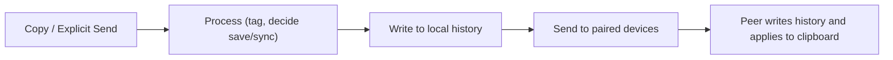

unic syncs the clipboard between devices that are paired and mutually approved. Every copy is written to **local history** first, then sent to other devices according to your settings; a failed send never rolls back local history.

## What happens on a copy



- **Processing**: Built-in classifiers and plugins can only add tags, set expiration, or block sync—they **never modify the content**. What you copy is what gets synced.
- **Commit**: Content is saved to local history first; it is still saved even if sync is off, no devices are paired, or the network is disconnected.
- **Send**: Sending happens only after commit succeeds. Failures are recorded in that history item's sync status without retrying interrupted sends; incomplete sends are marked as interrupted after a service restart.
- **Receive**: The peer checks size, type policy, and available storage before accepting the payload. Received content is **never forwarded again** to a third device.

## Supported Content

| Type | Notes |
|---|---|
| Text / Rich Text | Rich text is text with HTML |
| Images | Transferred in image formats such as PNG |
| Files | Default per-file limit is 100 MB (`limits.max_file_bytes`) |
| Folders | **Not synced automatically** by default; send explicitly, see [Folders](#folders) |

## Common Settings

Change these in the desktop Settings UI, or write them to `config.toml` with `unic config set` (takes effect on save):

| Config Key | Default | Purpose |
|---|---|---|
| `sync.enabled` | `true` | Master switch; when off, history is recorded locally only |
| `sync.automatic` | `true` | Auto-send after copy; when off, only explicit sends sync |
| `sync.files` | `true` | Whether to send and receive files (applies in both directions) |
| `sync.on_restore` | `false` | Whether restoring an item from history sends it to other devices again |
| `sync.directories.automatic` | `false` | Whether copying a folder automatically prepares and sends it |
| `limits.max_file_bytes` | `100MB` | Maximum size per transferred file; larger files can still enter local history |

Each sync backend can also independently configure whether to transfer text, images, and files, as well as an auto-send file size threshold (`plugins.instances.<backend>.sync.auto_file_max_bytes`, where `0` means no extra limit). Explicit sends are not subject to this auto-send threshold. See [Configuration Reference](../reference/configuration) for all options.

```bash
unic config set sync.automatic false
unic config set limits.max_file_bytes '"200MB"'
```

## Explicit Send

When you don't want to wait for automatic sync, or when automatic sync is disabled, send explicitly:

```bash
echo hello | unic send --to all          # Send to all paired devices
unic send --to laptop "hello"            # Send to a specific device (name or ID)
unic send --to all -f ./report.pdf       # Send a file
unic history send @1 --to laptop         # Resend the latest history item
```

`unic send` waits for the send to finish: if the content is saved but sending did not complete for all targets, it exits with code `4`. Omitting `--to` starts a [Quick Transfer](./quick-transfer) instead.

## Folders

When you copy a folder, unic by default records only a **source reference** in local history without scanning its contents or sending it. Send explicitly when needed:

```bash
unic send --to all -f /absolute/path/to/folder
unic history send @1 --to laptop
```

Only an explicit send reads the folder's current contents and creates an immutable snapshot for all targets. Key points:

- You can mix files and folders in one selection; empty folders and hidden files are preserved.
- Symlinks, junctions, and special files cause the entire send to fail rather than being skipped.
- Owners, permissions, timestamps, and extended attributes are not preserved.
- Limits: at most 128 top-level items, 4,096 entries, and 2,048 files.
- Folders must be sent to paired devices (`--to`); [Quick Transfer](./quick-transfer) does not support folders.
- Changes to the source folder after sending are not synced automatically.

When `sync.directories.automatic` is enabled, copying a folder also automatically prepares and sends it; a newer copy cancels any unfinished folder preparation.

<Callout type="warn">
The Linux desktop app currently cannot distinguish "copying the same folder again"; use explicit send for repeated selections. Native clipboard and cross-app paste acceptance across platforms is still in progress.
</Callout>

## Related Pages

- [Devices & Pairing](./devices)
- [Quick Transfer](./quick-transfer)
- [History & Search](./history-and-search)
