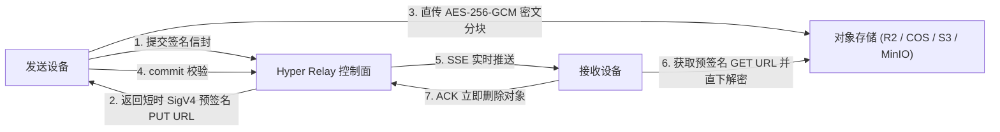

当已配对设备在线且直连可用时，unic 始终**优先走 P2P 直连**，不经过任何中转服务器。只有当目标设备暂时离线或处于冷启动阶段（例如移动端从后台唤醒、跨蜂窝网络分享）时，unic 才会自动启用**混合中转（Hyper Relay）**，实现 **0 等待立即开始发送**，同时在后台唤醒 P2P 连接。

<Callout>
混合中转仅用于短时端到端加密暂存（默认 10 分钟过期、接收确认后立即删除），**不是**云端剪贴板历史仓库。中转服务和对象存储均无法读取你的正文、文件名、MIME 类型或来源应用。
</Callout>

## 两类独立中继程序的区别

unic 生态中存在**两类职责完全正交、独立部署**的中继程序，请勿混淆：

| 维度 | Tailcat P2P / DERP 中继节点 | Hyper 混合中转服务（`UniClipboard/relay`） |
|---|---|---|
| **作用层次** | 传输 / 隧道层：协助 `builtin.tailcat` 完成 NAT 穿透与 WireGuard 实时字节转发 | 应用 / 分块层：对端离线时的 0 等待 E2EE 临时分块控制面 + SSE 实时通知 |
| **是否暂存载荷** | 否，纯在线实时转发，要求两端同时在线完成隧道握手 | 是，密文分块经预签名 URL 暂存于对象存储（默认 10 分钟 TTL），领取确认即删 |
| **密文数据流向** | 经由 DERP 节点转发加密隧道流量 | **Direct-to-S3**：密文分块直连客户端与 S3/COS/R2/OSS/MinIO，**不经过中转服务器** |
| **独立与自部署关系** | 归属 `builtin.tailcat` 传输栈，与混合中转完全解耦 | 独立 HTTP 服务（Go 容器或 Cloudflare Workers），可与 DERP 各自独立自部署或同时自部署 |

下文如无特别说明，“混合中转”均指 **Hyper 混合中转服务**（开源仓库：[UniClipboard/relay](https://github.com/UniClipboard/relay)）。

## 工作原理



- **P2P 在线零中转**：目标设备 P2P 会话已连接时，内容直接经 P2P 发送，中转请求数为 0。
- **离线 0 等待回退**：目标设备暂无活跃 P2P 连接，且内容大小不超过单次中转上限（官方默认 **25 MB**）时，立即走 HTTPS 加密上传，同时后台异步唤醒 P2P 重连。
- **Direct-to-S3 数据面分离与全球就近存储**：官方统一入口域名为 `https://relay.uniclipboard.app`（保证全球设备与跨区/切代理时的 `relay_origin` 与 `mailbox_id` 始终一致），控制面只处理极小的 JSON 消息、Ed25519 鉴权、SSE 推送与短时效 AWS SigV4 预签名；数据面按请求区域自动就近路由——**中国大陆直传腾讯云 COS，海外直传 Cloudflare R2**，跨区设备之间也能无缝下载解密。自部署时同样支持任意 S3 兼容存储，即使 1 vCPU / 1 Mbps 的轻量服务器也能稳定承载大文件传输。
- **大载荷中途 P2P 接力续传**：超过 2 MiB 的内容按 1 MiB 独立加密分块；如果上传中途目标设备恢复了 P2P 连接，双方会自动通过位图结算已传分块，剩余分块无缝切至 P2P 续传并在接收端统一组装校验，接收完成后立即清理云端临时对象。若 P2P 中途断开，也可平滑回落 HTTP 补齐。
- **零知识端到端加密**：直接复用既有设备配对的 Ed25519 身份密钥（映射为 X25519）与随机 AES-256-GCM 内容密钥（CEK），无需账号、无需重新配对。移除设备或暂停同步时，本机立即中止在途中转并吊销该设备的投递令牌。

## 客户端配置与 Cloud 一键授权

官方托管中转服务（`https://relay.uniclipboard.app`）需要通过 **UniClipboard Cloud**（`https://cloud.uniclipboard.app`）登录获取用户专属 **API Key** 授权使用；新安装未授权前默认关闭，避免未认证流量空转。你也可以随时切换为自部署地址，或完全关闭中转。

### 一键跳转登录并自动填入 API Key（推荐）

- **桌面端**：打开「设置 → 同步 → 混合中转」，点击 **「登录 Cloud 获取 API Key」**。浏览器完成登录后会自动回调本机，填入 API Key 并开启混合中转。
- **移动端（iOS / Android）**：打开「设置 → 网络 → 混合中转」，点击 **「登录 UniClipboard Cloud 获取 API Key」**，浏览器授权后自动跳回 App 完成配置。
- **命令行（CLI）**：运行以下命令即可在浏览器完成授权并自动写入 `config.toml`（无桌面环境可加 `--no-browser` 手动复制链接，或前往 `https://cloud.uniclipboard.app/account/api-keys` 生成后手动配置）：

```bash
unic relay login
```

### 配置文件与命令行

编辑 `$UNIC_HOME/config.toml`（保存即生效），或使用 `unic config set`：

```toml
[sync.relay]
enabled = true
url = "https://relay.example.com"  # 留空使用官方默认地址或 $UNIC_RELAY_URL
access_key = ""                    # 官方 Cloud API Key 或自部署 X-Unic-Relay-Key
max_bytes = "25MB"                 # 单次中转上限，最大不超过 4GiB
```

```bash
# 关闭混合中转（零中转网络请求）
unic config set sync.relay.enabled false

# 切换为自部署地址并提高单次上限
unic config set sync.relay.url '"https://relay.example.com"'
unic config set sync.relay.max_bytes '"100MB"'
```

也可以通过环境变量 `UNIC_RELAY_URL`、`UNIC_RELAY_ACCESS_KEY` 与 `UNIC_CLOUD_URL` 提供默认值（配置文件中的显式值优先），见[环境变量](../reference/environment)。

<Callout type="warn">
出于防 SSRF 安全限制，客户端只接受合法的公网 HTTPS 中转地址，绝不会自动连接对端自报的未知域名或内网 IP。使用自部署实例时，请确保需要互通的设备填写**相同的中转地址**，并在配置完成后至少完成一次 P2P 连接以交换投递路由。
</Callout>

## 自部署准备：配置对象存储

Hyper Relay 兼容任何支持标准 AWS SigV4 的 S3 对象存储。请先准备一个**私有存储桶**，并获取具备该桶读写与删除权限的 Access Key / Secret Key：

| 对象存储 | `S3_ENDPOINT` | `S3_REGION` | `S3_FORCE_PATH_STYLE` |
|---|---|---|---|
| **Cloudflare R2** | `https://<ACCOUNT_ID>.r2.cloudflarestorage.com` | `auto` | `true` |
| **腾讯云 COS** | `https://cos.<region>.myqcloud.com` | 如 `ap-guangzhou` | `false`（桶名为 `<name>-<appid>`） |
| **AWS S3** | `https://s3.<region>.amazonaws.com` | 如 `us-east-1` | `false` |
| **阿里云 OSS** | `https://oss-<region>.aliyuncs.com` | 如 `oss-cn-hangzhou` | `false` |
| **本地 MinIO** | `http://minio:9000`（配合 `S3_PUBLIC_ENDPOINT`） | `us-east-1` | `true` |

<Callout type="warn">
**强烈建议配置存储桶 1 天兜底生命周期规则**：在对象存储控制台中，对前缀 `mailboxes/` 添加「创建 1 天后自动删除对象」规则。虽然正常消费（ACK）、取消和 TTL 到期都会立即触发 `DeleteObject`，但客户端异常断网中断上传时，1 天生命周期规则能确保不遗留孤儿密文分块。
</Callout>

## 自部署方案一：Docker Compose（VPS / 轻量应用服务器 / NAS）

适合已有公网 VPS、腾讯云轻量应用服务器 / CVM、Kubernetes 或带公网反代的 NAS。容器镜像为轻量 distroless Go 服务（`ghcr.io/uniclipboard/hyper-relay:latest`），内存占用极低，适合长期维持大量 SSE 连接且固定计费。

### 1. 准备配置文件

```bash
git clone https://github.com/UniClipboard/relay.git
cd relay
cp .env.example .env
```

编辑 `.env`，填入你的公网域名、对象存储凭据和访问控制密钥（以腾讯云 COS 为例，若用 R2/S3/OSS 请按上表替换）：

```dotenv
# 必填：对外访问的 HTTPS 源地址（必须与客户端配置一致，不含尾斜杠）
HYPER_ORIGIN=https://relay.example.com

# 防白嫖：二选一或同时启用（详见下文）
RELAY_ACCESS_KEY=your-strong-random-key
RELAY_ALLOWED_PUBKEYS=

# 对象存储配置（示例为腾讯云 COS）
S3_ENDPOINT=https://cos.ap-guangzhou.myqcloud.com
S3_REGION=ap-guangzhou
S3_BUCKET=uniclipboard-relay-1250000000
S3_ACCESS_KEY_ID=your-access-key-id
S3_SECRET_ACCESS_KEY=your-secret-access-key
S3_FORCE_PATH_STYLE=false
S3_KEY_PREFIX=mailboxes
S3_PRESIGN_TTL=5m

# 可选配额调整（默认 25 MiB / 10 分钟 TTL / 单信箱最多 32 笔活跃传输）
HYPER_MAX_TRANSFER_BYTES=26214400
HYPER_DEFAULT_TTL=10m
HYPER_MAX_TTL=30m
```

如果不想使用外部云对象存储，可在同机启用内置 MinIO profile（需为 MinIO 单独配置公网 HTTPS 入口并填入 `S3_PUBLIC_ENDPOINT`）：

```bash
docker compose --profile minio up -d
```

### 2. 启动并验证健康检查

```bash
docker compose up -d
curl --fail http://127.0.0.1:8080/healthz
# 预期返回：{"service":"hyper-relay","status":"ok","storage":"s3-direct"}
```

### 3. 配置反向代理与 SSE 支持

将公网 HTTPS 流量反代至 `127.0.0.1:8080`。使用 **Nginx** 时，务必对 `/v1/relay/mailboxes/` 下的 SSE 事件流关闭缓冲并延长读超时，否则实时通知会被缓存导致延迟或断流：

```nginx
server {
    listen 443 ssl http2;
    server_name relay.example.com;

    # TLS 证书配置略

    location ~ ^/v1/relay/mailboxes/[^/]+/events$ {
        proxy_pass http://127.0.0.1:8080;
        proxy_http_version 1.1;
        proxy_set_header Connection "";
        proxy_set_header Host $host;
        proxy_set_header X-Forwarded-Proto $scheme;
        proxy_buffering off;
        proxy_cache off;
        proxy_read_timeout 1h;
    }

    location / {
        proxy_pass http://127.0.0.1:8080;
        proxy_http_version 1.1;
        proxy_set_header Host $host;
        proxy_set_header X-Forwarded-Proto $scheme;
        client_max_body_size 2m;
    }
}
```

使用 **Caddy** 时默认支持流式传输，直接配置即可：

```text
relay.example.com {
    reverse_proxy 127.0.0.1:8080 {
        flush_interval -1
    }
}
```

## 自部署方案二：Cloudflare Workers + Durable Objects 一键部署

适合个人或小团队零运维部署。控制面运行在 Cloudflare Workers 与 SQLite Durable Objects 上（按 `mailbox_id` 分片，通过 `alarm()` 自动清理过期记录），对象存储可直连 **Cloudflare R2**，也可跨云直连 **腾讯云 COS / AWS S3 / 阿里云 OSS**。

### 一键部署

点击 [Deploy to Cloudflare](https://deploy.workers.cloudflare.com/?url=https://github.com/UniClipboard/relay/tree/main/deploy/cloudflare) 按引导授权仓库并创建 Worker。

### 手动 Wrangler CLI 部署

```bash
git clone https://github.com/UniClipboard/relay.git
cd relay/deploy/cloudflare
npm ci
```

1. **配置非敏感变量**：编辑 `wrangler.jsonc` 中的 `vars`（或在 Cloudflare Dashboard → Worker → Settings → Variables 中配置）。以 Cloudflare R2 为例：

```jsonc
"vars": {
  "RELAY_ORIGIN": "https://relay.example.com",
  "S3_ENDPOINT": "https://<ACCOUNT_ID>.r2.cloudflarestorage.com",
  "S3_REGION": "auto",
  "S3_BUCKET": "uniclipboard-hyper-chunks",
  "S3_FORCE_PATH_STYLE": "true",
  "S3_KEY_PREFIX": "mailboxes",
  "S3_PRESIGN_TTL_SEC": "300"
}
```

2. **创建 R2 桶并配置 1 天生命周期兜底**（若使用 R2）：

```bash
npx wrangler r2 bucket create uniclipboard-hyper-chunks
npx wrangler r2 bucket lifecycle add uniclipboard-hyper-chunks expire-orphaned-chunks \
  --prefix mailboxes/ --expire-days 1
```

3. **通过 Secrets 注入敏感凭据**（切勿将密钥写入 `wrangler.jsonc` 或 Git）：

```bash
# 在 Cloudflare Dashboard → R2 → Manage R2 API Tokens 创建仅限该桶读写的 Token
npx wrangler secret put S3_ACCESS_KEY_ID
npx wrangler secret put S3_SECRET_ACCESS_KEY

# 强烈建议：为个人自部署配置接入密钥防白嫖
npx wrangler secret put RELAY_ACCESS_KEY
```

4. **绑定自定义域名并部署**：在 `wrangler.jsonc` 中添加 `routes`（`custom_domain: true`）或在 Dashboard 中绑定自有域名，然后执行：

```bash
npx wrangler deploy
curl --fail https://relay.example.com/healthz
```

<Callout type="warn">
不要将默认的 `*.workers.dev` 子域长期用于日常同步：该域名在部分地区访问不稳定，且无法挂载 Cloudflare Zone 级 WAF 与限流规则。同时请务必配置 `RELAY_ACCESS_KEY` 或 `RELAY_ALLOWED_PUBKEYS`，避免他人创建陌生信箱消耗你的 Durable Objects 与 R2 额度。
</Callout>

<Callout>
关于腾讯云 Serverless：腾讯云 EdgeOne Pages Functions、SCF 与云托管目前缺少类似 Durable Objects 的单写者有状态协调与长连接 SSE 广播能力，因此不提供腾讯云 Serverless 一键模板。腾讯云用户推荐在**轻量应用服务器 / CVM 上运行 Docker Compose + 腾讯云 COS**，或使用 **Cloudflare Workers + 腾讯云 COS** 组合。
</Callout>

## 防白嫖与公网安全加固

自部署实例暴露在公网时，支持两类**零知识兼容**的实例准入控制，可单独启用或同时叠加：

### 1. 共享实例接入密钥（`RELAY_ACCESS_KEY`）

- **服务端**：在 `.env`（Docker）或 `wrangler secret put RELAY_ACCESS_KEY`（Cloudflare）设置高熵随机密钥（例如 `openssl rand -base64 32`）。
- **验证方式**：服务端对所有控制面请求（含 Owner Auth 与发送方 `Bearer` 请求）使用常量时间校验 HTTP Header `X-Unic-Relay-Key`，未携带或错误直接返回 `401`。
- **客户端**：在桌面端/移动端「自部署接入密钥」输入，或在 `config.toml` 设置 `sync.relay.access_key`，或通过环境变量 `UNIC_RELAY_ACCESS_KEY` 传入。
- **秘密保护**：客户端向预签名对象存储 URL 直传/直下时会自动**剥离** `X-Unic-Relay-Key` 与所有 `X-Unic-*` 请求头，绝不向对象存储或日志泄露密钥。

### 2. 设备公钥白名单（`RELAY_ALLOWED_PUBKEYS`）

- **服务端**：设置逗号分隔的设备 Ed25519 公钥（无填充 base64url 编码），仅允许白名单内的设备执行 Owner Auth（登记/吊销投递令牌、订阅 SSE、拉取分块与确认消费）。
- 即使陌生人猜到你的中转域名，也无法在你的实例上注册信箱或触发对象存储写入。
- **推荐组合**：个人自用时可先开启 `RELAY_ACCESS_KEY` 快速拦截全部未授权请求；对安全性要求更高时再叠加 `RELAY_ALLOWED_PUBKEYS` 锁定具体设备。

### 3. 其它加固建议

- **配额与限流**：合理设置 `HYPER_MAX_TRANSFER_BYTES`、`HYPER_MAX_TRANSFERS` 与反向代理/Cloudflare 速率限制（Rate Limiting），防止突发流量打满对象存储请求数。
- **监控健康检查**：定期探测 `GET /healthz` 并关注存储桶对象数量；正常情况下对象数量会在几分钟内随消费确认或 TTL 自动归零。

## 相关页面

- [剪贴板同步](./sync)
- [设备与配对](./devices)
- [隐私与安全](./privacy-and-security)
- [配置文件](../reference/configuration#syncrelay)
- [环境变量](../reference/environment)
