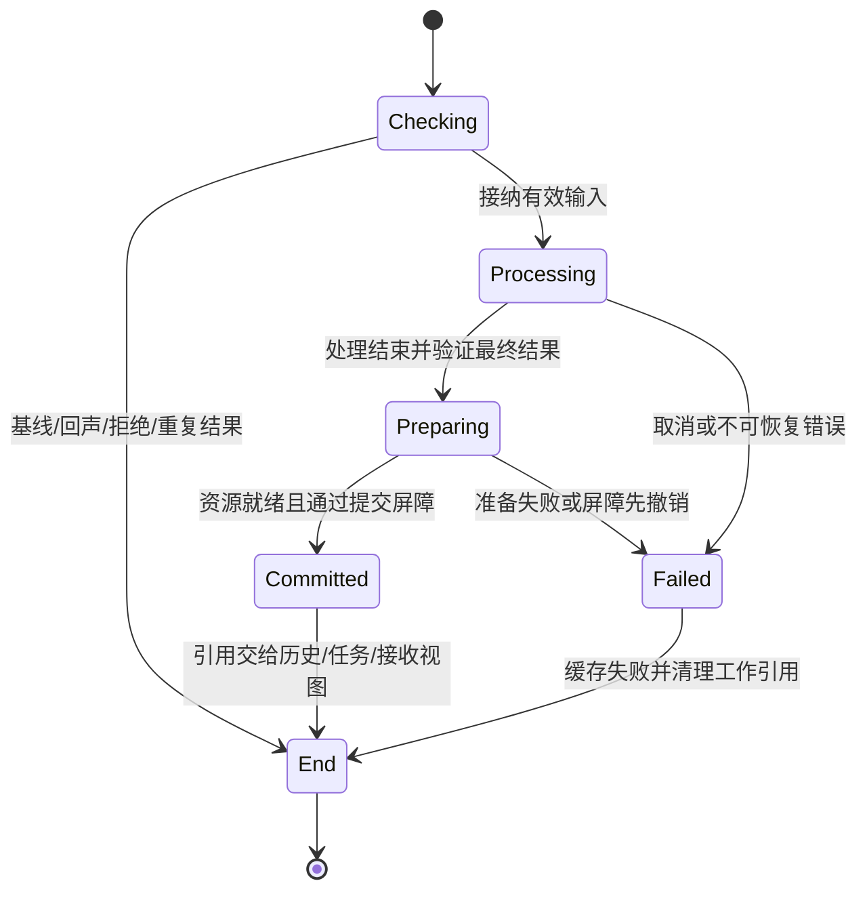

# 流水线提交契约 v0.1

- 状态：提交结果、幂等、状态转换与资源所有权契约已确定，待实现；自动写回票据见[写回契约](clipboard-writeback-contract.md)，RPC 核心帧与控制载荷见[RPC 核心协议](plugin-rpc-contract.md)，后端业务 DTO 见[同步后端契约](sync-backend-contract.md)，Lua 预算方案见[运行时契约](lua-runtime-contract.md)，各项实现验证仍按执行计划补齐。
- 日期：2026-11-07。
- 字段的具体 Go 类型、可选指针、目标结构与错误分类见[SDK 扩展类型契约](sdk-extension-contract.md)，仍待实现。
- 依据：[0004](decisions/0004-clipboard-pipeline-lua.md)、[Engine 契约](engine-contract.md)、[历史契约](history-contract.md)、[插件契约](plugin-contract.md)。本文件是 Engine 的目标扩展，不表示已有代码支持下述 API。

实现登记：P1 首批已接入私有 captured/received 处理核心、暂存/回滚、协作取消及旧网络适配，默认无处理器。legacy 提交已增加独立有界结果缓存（成功/失败、TTL/容量驱逐、processing 不淘汰），调用者取消只停止等待。观察接纳已与处理分离，最新已接纳位置与成功基线分开维护，旧结果不覆盖新观察/epoch/应用基线。以下公开提交 API、持久 commit 与提交事件仍待实现；缓存当前保存旧门面网络结果，不能视作持久提交结果。

## 1. 将 commit 与发送结果分开

一次提交可能已完成处理和历史入库，却因策略、无目标或无后端没有发送。SDK 必须明确返回这两个结果，不能让宿主根据一个发送错误推断“没有入库”，更不能因此自动重跑处理器。

新增 API，保留原 SubmitContent 签名作为兼容门面：

```go
func (e *Engine) CommitContent(ctx context.Context, req CommitRequest) (SubmissionResult, error)
func (e *Engine) GetSubmission(ctx context.Context, id RequestID) (SubmissionResult, error)
```

`CommitRequest{RequestID, LeaseID, WritebackGuard, BackendIDs}`（可空 WritebackGuard 见[写回契约](clipboard-writeback-contract.md)） 仅用于宿主显式提交，Origin 固定 explicit。自动捕获和接收使用同一内部提交器，不允许宿主伪造 remote_device、plugin 或跳过观察协议。BackendIDs 可选择已启用后端子集，规则见[0007](decisions/0007-multiple-sync-backends.md)；调用者没有“跳过插件”或单独强制 persist/sync 的参数；策略由配置和处理器决定。

`SubmissionResult` 是无正文的独立快照：

| 字段 | 语义 |
|---|---|
| RequestID | 本次提交的调用标识，不包含正文或秘密 |
| Phase | processing/committed/failed；CommitContent 成功返回时必为 committed，GetSubmission 可观察其余状态 |
| ItemID | 实例内不透明处理对象 ID，接纳请求时分配；与 HistoryID、ContentID 分开 |
| HistoryID | 仅成功 persist=true 的 commit 非空，跨重启稳定 |
| SyncDisposition | not_requested/disabled/no_backend/no_targets/policy_filtered/queued/failed；processing 或 failed 阶段为空 |
| OperationID | 仅 queued 非空，引用原有发送 Operation；后续发送进度在 GetOperation 获取 |
| BackendResults | 各后端独立的 BackendID/Disposition/Error；含类型过滤与 auto_file_too_large，聚合规则见 0007 |
| SyncError | 仅 SyncDisposition=failed 非空，为稳定脱敏 Error |
| Error | 仅 Phase=failed 非空，表示 commit 前的终态错误 |

SubmissionResult 另含可随任务状态更新的 Writeback 字段，状态与领取 API 见[写回契约](clipboard-writeback-contract.md)；提交终态与同步决策不随写回改变。此结果不携带可直接读正文的句柄或写回票据，persist=false 也不能依靠 ItemID 重新获取已回收资源。HistoryID 可能在结果缓存保留期内已被删除/到期，再查历史返回 not_found 属于正常情况。

GetSubmission 的 RequestID 只用于当前实例，不是跨重启恢复凭证；未知或已回收返回 not_found。重启不恢复 processing、缓存错误或未决网络派发；历史按自身契约保留。

## 2. 接纳、处理与 commit 的原子边界

1. 先校验请求形状、RequestID 保留命名空间与幂等键；同键重试优先于租约和运行条件检查。
2. 新请求要求 running/active，允许无后端和同步关闭。检查原始内容租约、导入限制和有界请求表容量，取得内部内容引用并创建 processing 记录。此前失败不接纳请求，不产生缓存或处理副作用。
3. 接纳后以 Engine 工作 context 执行 captured 处理器，按顺序暂存与采纳 patch，再准备最终资源；取消调用者 context 只停止等待，不取消已接纳工作。Stop/挂起取消仍未提交的工作，结果缓存为 failed；不得迟到 commit。
4. persist=true 时，按历史契约原子提交历史、必要淘汰、历史修订与资源引用；同时将提交结果变为 committed。persist=false 时以同一可见提交边界接受最终不可变 Item/Policy，并保留操作期资源。commit 前任何终态失败都为 failed，不产生 committed 通知、历史或发送。
5. commit 时决定同步是否请求并预留必要操作/调度状态；网络派发只能在 commit 成功后开始。结果、历史与发送任务的对外可见性统一序列化，不允许查询到“同一请求未提交”却已看到发送。

处理器失败按 continue/block_sync 回滚该处理器 patch，本身不必导致 Phase=failed；仍可能成功 commit。自由文本错误、stderr、正文和源文件路径不能进入 SubmissionResult。

commit 成功后不再把网络调度失败作为 CommitContent 的 error 返回；以 SyncDisposition/SyncError 或已创建 Operation 的终态表示。调用者可在 CommitContent 等待中收到 context 超时，此时必须用原 RequestID 查询/重试，不能推断工作失败。提交前后同时发生 Stop 或配置更新时，通过同一序列化提交点确定谁先生效。

## 3. 同步决策

在 commit 可见提交点，按[0007](decisions/0007-multiple-sync-backends.md) 执行：先检查全局 sync.enabled 和条目 Policy，再为选定且启用的后端独立过滤类型、判断自动文件阈值、校验授权/限额并建立目标任务。captured 自动提交受阈值约束，explicit 手动提交只跳过阈值；不能越过类型开关或全局授权。原始导入/处理限制仍在 commit 前校验。

各后端结果保存在 BackendResults，任一有任务则聚合 queued，返回一个涵盖实际目标的 OperationID；没有任务时 disabled/not_requested/no_backend/failed/no_targets/policy_filtered 的优先级按 0007。实际目标键是 (BackendID, TargetKind, TargetID)，其他后端的失败/跳过不得冒充某目标发送成功。历史保存过滤前的最终内容，同一提交只处理和 commit 一次。

首次派发决策不因后来联网或放宽策略而自动补发。开始每个目标传输前再次校验；普通类型/阈值/限额更新只影响之后开始的工作，全局关闭、挂起及撤销信任立即取消在途内容工作。queued 只表示任务建立；P2P sent 仅为写完，repository 目标完成仅表示对象写入，不表示其他设备已收到或应用。通知不承担派发。

## 4. 幂等、并发与保留

新增独立 submission 表，不能仅依赖发送 Operation 的 RequestID 索引：没有网络任务的 commit 和失败也必须去重。显式 CommitContent 和 SubmitContent 共用同一命名空间与记录，语义参数为原始 LeaseID、explicit 来源、可空 WritebackGuard 及规范化 BackendIDs；改变参数使用同一键返回 conflict，不用已处理内容 hash 代替原始参数比较。

同键并发只接纳一次，其他调用等待或查询同一结果；不会并发执行两遍插件。processing 返回给 GetSubmission；CommitContent 等待终态。重复识别早于租约校验，因此调用者释放原租约后仍可取得原结果。外部文件变化也不得导致已提交请求重跑。

已接纳请求的终态成功和失败都缓存。相同键重试失败仍返回原错误，不再处理；成功重试只读取原提交及最新 Writeback 快照，不重建任务；修改参数或希望重新尝试必须使用新 RequestID。插件可能产生无法回滚的外部副作用，幂等只保证 Engine 在保留期内不重复调用，不能提供外部事务保证。

创建选项 ResourcePolicy 新增 MaxSubmissions（默认 1024，>0）与 SubmissionTTL（默认 30 分钟，>0），独立于操作表。processing 不淘汰；终态从完成时计 TTL，容量压力可提前淘汰最旧终态记录。无可淘汰槽位则接纳前 resource_exhausted。查询和重试不延长保留期，驱逐不删除历史或中止发送。

GetSubmission 结果中的 OperationID 可能先于 submission 被驱逐，GetOperation 返回 not_found 不会让 committed 失效。超出保留期后不再承诺去重，宿主不得将旧键当成永久幂等凭证，需遵守原 Engine 契约使用新 RequestID。

RequestID 禁止宿主使用 `obs:` 与 `recv:` 前缀，它们由 Engine 保留。观察键是实例/epoch/sequence，接收请求键是本次已完成接收的内部标识。它不同于 0007 定义的跨后端成功接收去重键；后者必须结合已认证来源、TransferID 与 ViewHash 并按有界持久记录处理，不能只信任对端 wire ID。

## 5. 原 API 与观察协议迁移

SubmitContent 保留原 `(OperationID, error)` 签名、explicit 限制与网络返回码，通过同一提交器取得已缓存结果再映射：queued 返回 OperationID；not_requested/disabled 返回 sync_disabled；no_backend 返回 unsupported；no_targets 返回 no_targets；policy_filtered 返回 sync_disabled；failed 返回 SyncError；commit 前失败返回 Error。这些网络错误可发生在历史已保存之后，宿主展示结果应迁移到 CommitContent/GetSubmission，不能自动创建新请求重试。

相同语义参数（含空 WritebackGuard 及省略 BackendIDs）的 RequestID 跨 CommitContent/SubmitContent 仍读取同一结果，门面差异不能重复 commit。原 SubmitContent 不能传 guard，因此带 guard 的 CommitContent 与它不是相同语义参数，跨门面复用此键返回 conflict。旧 HTTP `/v1` 响应形状保持；如需展示历史结果，使用新增适配接口，不能往旧响应隐式混入正文或破坏其字段含义。

ObservationResult 增加可空 Submission 字段（SubmissionResult 快照），原 Disposition/OperationID 保留。baseline/empty/unchanged/echo 不建立 submission；有效变化即使无目标、同步关闭或无后端也完成处理/commit，并在结果中返回历史标识。

commit 后的观察处置映射：queued→submitted，disabled/not_requested→disabled，no_targets→no_targets，no_backend→新增 local_only，policy_filtered→disabled，failed/limit_exceeded→too_large，其余 failed→新增 sync_failed。commit 已完成的处置均推进原始观察基线，不因网络失败重报；插件最终内容写回后的基线仍由单独 apply token 协议确认，不能直接假定已写系统剪贴板。

commit 前失败不推进基线，但已接纳失败的同一 epoch/sequence 仍命中失败缓存。需要主动重试时宿主使用新的、更大 sequence 与有效租约；不得把旧 sequence 改参数重报。尚未接纳的失败可用同一请求重试。观察重复窗口至少覆盖当前 epoch 最近一次已接纳结果（含失败），独立于普通 submission 表 TTL；新 epoch 和 Stop/挂起使其按观察协议失效。

没有 Observe 能力的显式提交仍可处理与入库；SDK 不假定宿主已写入处理后的正文。本机自动写回的票据、失败处置与来源深度已在[写回契约](clipboard-writeback-contract.md) 确定，实现仍待完成。

## 6. 接收、生命周期与资源

接收必须先通过对应后端的来源认证/信任、全局及该后端同步策略、跨后端去重与配额准入，再以收到的完整资源运行 received 处理。首版不转发；commit 后才创建 Received 视图和允许 BeginApply。persist=false 仍可接收应用，Received 独立持有资源。持久化失败不返回一个假装可用的接收条目；清理半成品并以无正文的 receive.failed 通知结束，不增加 wire ACK。

提交器从接纳到 commit/失败持有原始和暂存内容；成功后历史、Received、Operation、待写回任务分别取得自己的引用，再释放处理引用。任一失败、取消或崩溃恢复均遵循历史资源清理范围，不能删除用户源文件。submission 元数据缓存本身不长期持有正文；persist=false 且无操作/应用/租约持有后即可回收内容，结果缓存仍可查询。

GetSubmission 在 created/running/stopping/stopped 可查询；closed 返回 closed。新 CommitContent 只在 running/active 接纳，重复终态在其他未关闭生命周期也可查询返回；processing 的重试仍可等待已有工作。Stop/挂起取消未 commit 工作并写入终态失败，已 commit 的历史保持，已创建网络任务按原契约终止。Close 等工作回收后才释放数据库和目录锁。

State 不包含整张 submission 表。新增 `submissions` 事件，仅用 Objects 引用公开 RequestID，接纳与终态各产生修订；消费者用 GetSubmission 查询，事件溢出沿用 resync_required。宿主应保留自己发起的 RequestID，GetSubmission 的查询保留期是恢复范围，不提供全量任务重放。历史与 submission 同批 commit 的事件不能让消费者观察到半提交状态。

## 7. 状态转换与资源交接

本节的阶段是内部调度状态，不新增公开 Phase、生命周期枚举或恢复承诺。公开 submission 仍只有 processing/committed/failed；接收准入和应用各有自己的状态，不能将一次网络接收、一次 commit 和一次应用合成一个成功标记。

### 7.1 三类入口

| 入口 | 接纳前 | 接纳后的处理输入 | commit 后 |
|---|---|---|---|
| 自动捕获 | 校验观察 epoch/sequence、能力与内容；baseline/empty/unchanged/echo 直接结束，无 submission | 有效变化取得处理引用，保留内部观察位置，执行 captured | 历史可选；按后端决策同步；改写内容按 guard 建立本机写回待办；仅仍匹配的观察位置更新成功基线 |
| 显式提交 | 先查 RequestID，再校验运行条件、原租约和容量 | 取得独立处理引用，执行 captured；Origin 不允许调用方任意指定 | 历史可选；按 explicit 决策同步；有有效 guard 才可能自动写回 |
| 远端接收 | 认证、策略、去重占位、receive_id 与字节预留；完整流及原始 hash 校验后再过滤 | 取得完整且交付策略允许的输入，执行 received；内部标记 remote ingress 不可被插件改掉 | 同时发布 Received、可选历史和成功去重记录；不创建转发或本机改写写回任务；应用只经 BeginApply |

捕获/显式提交的接纳是第 2 节建立 processing 的时点；接收的 receive_open 只是资源准入，不表示已有 submission 或已执行 received。接收 submission 在完整内容校验/过滤成功、进入处理器前建立；先前失败仅结束 receive，不伪造提交记录。接收请求和观察请求使用内部命名空间，不经普通宿主提交入口。



Processing 内每个处理器使用独立 patch；成功才替换工作版本，失败释放其临时资源并按 continue/block_sync 继续。原输入引用始终保留到准备结束，不能让回滚依赖已释放内容。深度达到上限时跳过处理器，但仍经过 Preparing/提交屏障与同步策略。

Preparing 校验最终内容、Policy、宿主可写表示，并准备 blob/文件快照、配额和有界发布对象。persist=true 必须先完成自有快照；persist=false 不新增强制复制宿主引用文件的承诺，后续发送/读取仍按原文件版本校验规则进行。请求接纳不冻结宿主源文件；只有成功取得的自有快照可供重启后历史读取。

### 7.2 提交屏障与取消顺序

Engine 用统一提交协调器排列 commit、Stop/挂起和相关配置/撤销的生效顺序。处理器、文件复制、RPC 与等待宿主不得占用该协调器；进入提交屏障前已准备好资源。持久事务本身也有 context/忙等待边界，不能用无界 SQLite 等待阻止生命周期收敛。不得持普通业务锁等待插件或后端 ACK。

1. 屏障先核实工作代次仍有效。Stop/挂起先于提交屏障生效则失败并禁止迟到提交；本机任务遇到 sync.enabled=false 仍可 commit，只改变同步决策。远端接收遇到全局关闭、后端禁用或信任撤销先行生效，则取消接收，不能先存历史再声称接收被拒绝。
2. 接收在此处再次按当前后端策略判断。Preparing 后若策略变化使最终输入选择不再相同，放弃本次提交并结束为 discarded，释放占位；不发布已不合策略的结果，也不在同一次 receive 内重跑 received。插件外部副作用不能回滚。策略变化发生在进入处理器前时可按新策略过滤一次再执行。
3. 接收必须预留 Received 槽位或确定可淘汰且未锁定的条目，再进入持久事务；满表且无法腾位则失败，不发布历史/成功去重。预留的空槽对普通查询不可见；并发接收、TTL、Dismiss 和 BeginApply 不得抢走已预留槽位或锁定其淘汰候选。提交失败撤销预留，不能把淘汰候选先不可逆移除再假称回滚。
4. 持久事务包含可选历史及其淘汰/修订、接收成功去重记录。persist=false 接收仍需提交去重记录；失败同样不发布 Received。本机 persist=false 且无持久变更使用内存提交点。数据库提交成功即不可逆，不因随后观察到取消改写为 failed。
5. 在开放查询和投递事件前，发布对应 submission 终态、Received、操作/写回引用和修订。此段仅安装已准备对象，不调用插件/宿主，不执行仍可能正常失败的资源分配。查询经过同一屏障，不能穿过数据库已提交而实例状态尚未发布的窗口。进程崩溃按持久恢复边界处理，不能宣称内存对象与 SQLite 是跨重启事务。

commit 先行成功则后来的 Stop/挂起保持 committed，取消其后续网络/待办；取消不能回滚历史。同步任务预留失败可形成 committed + 同步失败，写回不支持/guard 冲突也只形成写回结果，不能归为准备失败。提交通知失败不改变任何已发布状态。

接收成功去重占位在所有校验、处理与提交阶段保持独占；相同键的其他后端遇到占位直接丢弃本次重复输入，不挂起等待另一次处理，也不提升为成功记录。首次失败释放占位，之后新到达的完整传输可重试，但此前被丢弃的副本不会自动恢复。commit 原子转为有界持久成功记录后，即使 persist=false 或历史后来删除，也不立即允许该键再次处理；按 0007 的容量/时间窗口淘汰后不再承诺去重。

### 7.3 引用与配额账本

“转交”指先取得后继独立引用，再释放前驱引用；共享引用不重复计算同一内容对象的逻辑字节。字节预留转为实际计费时结清差额，不能同时把完整预留和已接收字节各计一次。Received 槽位、流位、租约位是独立资源，不能用字节额度替代。

| 资源/持有者 | 取得时点 | 结束/转交 |
|---|---|---|
| 宿主原始 Lease | 导入/显式保留成功 | 宿主 ReleaseContent；提交器接纳后有自己的引用，不依赖宿主继续持有 |
| 接收去重占位、字节预留 | receive_open 准入成功 | 未消费 10 秒到期、流失败、取消/丢弃即释放；成功转去重记录与实际内容计费 |
| 接收流/半成品 | receive 根调用内打开 part | END 回收活跃流位；根调用到 commit/失败前仍持有完整内容及校验所需资源 |
| 原输入、工作版本与处理器暂存 | 请求接纳及逐个处理器执行 | patch 失败立即丢弃暂存；成功替换工作版本；提交/失败统一释放处理引用 |
| 自有快照/未发布 blob | Preparing 时先预留再复制 | 成功交给内容对象/持久引用；失败归还预留，私有孤儿按安全清理处理，不删除宿主文件 |
| Received 槽位预留/淘汰候选 | 提交屏障内、持久事务前 | 成功转 Received，失败原样释放；不留下可见半条目 |
| History 引用 | 历史事务提交并发布 | 删除/到期/淘汰只释放历史引用；活动读取/发送/应用继续持有 |
| Received 引用 | 接收 commit 发布 | Dismiss/TTL/成功应用移出视图时释放；被应用锁定时遵循原协议，不提前淘汰 |
| Operation/目标引用 | commit 创建实际目标任务 | 各目标 sent/failed/replaced/canceled 后释放自己的引用；其他目标仍可继续 |
| 写回 pending 引用 | commit 创建可用待办 | 超时/取代/取消释放；领取先创建 ticket 独立租约再释放 pending |
| ApplyTicket 租约、读取引用 | BeginApply/BeginApplyHistory/BeginWriteback 或 ReadContent 成功 | 报告结果结束应用槽；租约由宿主显式释放，读取引用到 reader.Close；两者不能互相替代 |
| Submission 缓存 | 接纳成功 | 只保留无正文结果，TTL/容量驱逐不触碰上述独立引用 |

根调用取消先封禁新句柄/流与迟到 patch，再取消子工作，待实际读写返回后归还对应流位/预留；不能先释放缓冲/文件再让尚未退出的写入继续使用。重复清理路径必须由一次性所有权交接保证只减计一次。需要因协议失步关闭连接时，关闭与 wait 遵循后端契约，不以丢弃内容引用代替网络回收。

### 7.4 Use、End 与恢复

应用不重新进入 captured/received，不再 commit 或同步。应用成功、失败或 deferred 只影响对应票据/视图；既有历史与同步结果保持。系统真实粘贴不可观测，不能把网络 sent、receive completed 或写入系统剪贴板当作用户已粘贴。

End 不是整个 Item 的单一终态：历史删除、Received 移除、目标结束、写回结束和租约释放各自终结。只有全部引用释放后内容才可回收；删除历史并不取消既有独立任务。receive.completed 表示本机接收 commit 成功，应用结果另循应用协议，不代表远端 ACK。

进程重启保留有效历史与成功去重记录；清理未发布孤儿和半成品，不恢复 submission/Received/Operation/写回/票据，不自动重放发送或处理器。persist=false 接收可能只剩成功去重记录而无可恢复内容，这是有界去重语义，不能据此承诺可靠离线投递。持久提交后、事件前崩溃通过历史查询恢复，不能依赖通知补做 commit。

## 8. 待实现的验收用例

- 相同请求并发/跨门面/释放原租约后重试，只执行一次 processor、commit 与派发；不同参数冲突。
- persist=true/false × 全局允许/禁止 × 多后端策略/阈值 × 有目标/无目标/无后端，结果字段与所有权一致，单次处理/commit 和目标资源引用正确。
- commit 前校验、插件、落盘、数据库失败均不发送；已接纳失败缓存，未接纳失败可重试。
- commit 成功后操作容量不足、后端故障、限额变化，以独立同步失败表示，不回滚历史或重跑处理器。
- 调用者超时后查回同一结果；Stop/挂起与 commit 竞争、迟到 patch、并发读取结果没有半提交。
- 观察 commit 后同步失败仍推进基线；commit 前失败不推进，旧序号命中失败，新序号可主动重试。
- submission/operation 独立驱逐、processing 不淘汰、满表接纳前失败；缓存不泄露或无限持有正文。
- 远端不转发，接收 commit 失败不创建 Received，接收通知不承诺远端可靠投递。
- Received 满表/锁定/并发 TTL 与槽位预留竞争，失败不留下历史或成功去重记录，候选淘汰不提前生效。
- 接收全阶段遇到全局关闭/后端禁用/撤销，以及插件期间类型策略改变；屏障先后决定成功或丢弃，不重跑 received。
- 双后端同键占位竞争、首份失败与后续新传输、persist=false 重启去重；过滤视图不同仍独立处理。
- 各阶段故障注入后核对引用、逻辑字节预留、槽位、流位及句柄账本，重复取消不双重释放，迟到写入不使用已回收资源。
- 数据库提交后/实例发布前/事件投递前崩溃恢复，仅历史和成功去重记录恢复，未决工作不重放。
